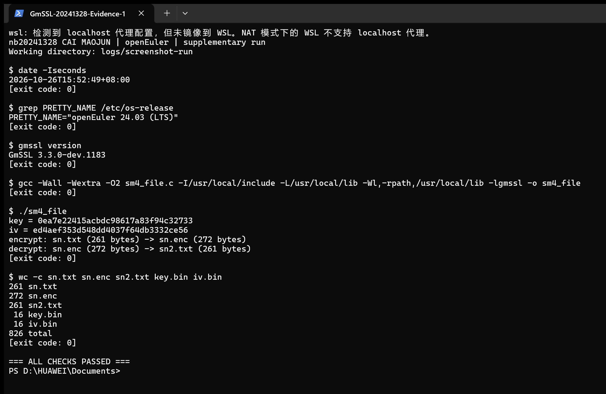
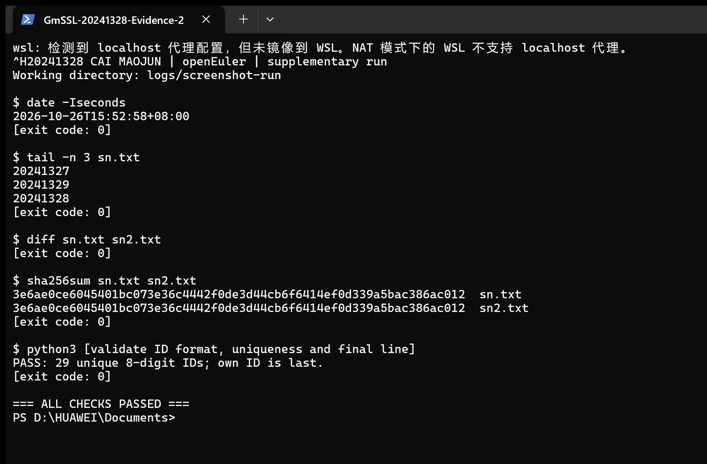

# GmSSL 的 SM4-CBC 文件加解密课堂测试

**姓名：蔡贸俊　学号：20241328　班级：2413**  
**实验日期：2026 年 10 月 26 日**

## 一、实验目的与完成情况

本次实验通过一个学号文本文件，练习 GmSSL 随机数接口和 SM4-CBC 加解密接口的使用。实验重点是把“随机生成密钥和 IV—加密文件—解密文件—比较结果”连成完整流程，并用实际命令验证文件是否恢复一致。

| 要求 | 本次实现与证据 | 结果 |
| --- | --- | --- |
| 在 Ubuntu 或 openEuler 中完成 | WSL2 中的 openEuler 24.03 LTS | 已完成 |
| 全班八位学号，本人排最后 | sn.txt，复用上次课堂文件，29 条无重复 | 已完成 |
| GmSSL 编程生成随机密钥与 IV（4 分） | 两次 rand_bytes，各生成 16 字节 | 已完成 |
| CBC 文件加密解密及代码、编译运行过程（8 分） | C 程序调用 SM4-CBC 流式接口，输出 sn.enc 和 sn2.txt | 已完成 |
| Linux diff 验证（2 分） | diff sn.txt sn2.txt，退出码 0 | 已通过 |
| 实践及 AI 问答文本、Markdown 与 PDF | 本报告、logs 中的文本与对话节录 | 已整理 |

## 二、实验思路与旧方法的应用

本次采用“先参考旧实验，再修改为文件处理，最后验证结果”的思路。以前的示例已经验证过 GmSSL 的基本调用方式，因此本次主要解决输入文件、随机 IV、分块读写和结果比较这几个问题。

1. **复用环境**：此前已安装 openEuler 和 GmSSL，不重复安装。
2. **准备学号文件**：将以前课堂使用的 `/root/hash_hw/sn.txt` 复制到本次目录。文件包含 20241301—20241329 共 29 个学号，本人学号 20241328 放到最后，再检查格式与重复情况。
3. **复用 API 方法**：查阅旧项目 `/root/roc-edu-student-exp_1/docs/hours4-6.md` 中“GmSSL 库编程实践”，沿用 `SM4_CBC_CTX` 与 `init/update/finish` 流程，将原来的字符串处理改成文件分块读写。
4. **复用链接经验**：显式设置头文件路径、库路径和运行时搜索路径，使用 `-lgmssl` 链接 GmSSL。
5. **先验证再总结**：保留命令、真实输出与退出码；遇到 CLI 填充参数差异时查明原因并重跑。

## 三、实验环境与输入

实际环境为 **openEuler 24.03 LTS（WSL2，x86_64）**，编译器为 **GCC 12.3.1**，密码库为 **GmSSL 3.3.0-dev.1183**。程序为 Linux ELF 64 位可执行文件。

`sn.txt` 每行一个八位学号，采用 LF 换行，无 BOM，最后一行也有换行。共 29 行，每行 8 个数字加 1 个换行，因此为 29 × 9 = **261 字节**。程序运行前已校验数量、格式、唯一性及最后一行。

```text
20241301
20241302
20241303
20241304
20241305
20241306
20241307
20241308
20241309
20241310
20241311
20241312
20241313
20241314
20241315
20241316
20241317
20241318
20241319
20241320
20241321
20241322
20241323
20241324
20241325
20241326
20241327
20241329
20241328
```

名单来源与 SHA-256 记录见 [logs/input-source.txt](logs/input-source.txt)。

## 四、原理与程序设计

### 1. 随机密钥与 IV

SM4 密钥长度为 128 位，分组长度为 128 位，因此 key 与 CBC 的 IV 均为 **16 字节**。使用 GmSSL 的 `rand_bytes` 分别生成两组随机字节，检查返回值为 1，不采用固定常量或 C 标准库 `rand()`。

```c
uint8_t key[16], iv[16];
if (rand_bytes(key, sizeof(key)) != 1 ||
    rand_bytes(iv, sizeof(iv)) != 1) {
    fprintf(stderr, "GmSSL rand_bytes failed\n");
    return 1;
}
```

本次最终运行生成的值如下（32 个十六进制字符对应 16 字节）：

```text
key = a472d9ab2c5a3e6c6e3620feb9b8aac2
iv = 4c11e0dc563792464501629e33d23d7f
```

程序将这组实验值分别写入 `key.bin`、`iv.bin`，便于使用命令行交叉验证。重新运行会生成新的随机值并覆盖本次运行产物。

### 2. SM4-CBC 与填充

CBC 加密满足 `C_i = E_K(P_i XOR C_(i-1))`，首块以前一个分组为 IV；解密满足 `P_i = D_K(C_i) XOR C_(i-1)`。解密必须使用与加密相同的密钥和**初始 IV**，因此每次操作分别初始化新的上下文。

程序以二进制方式读写文件，用 `update` 分块处理，并调用 `finish` 完成 PKCS#7 填充或去填充。261 除以 16 余 5，需要补 11 个 `0x0b`，所以密文为 **272 字节**；解密去填充后恢复 261 字节。

文件流程为：`sn.txt → SM4-CBC 加密 → sn.enc → SM4-CBC 解密 → sn2.txt`。

### 3. 代码各部分的作用

- `main`：生成随机密钥和 IV，保存实验参数，依次调用加密与解密函数。
- `crypt_file`：打开输入输出文件，初始化 CBC 上下文，循环读写数据，最后处理填充并关闭文件。
- `save_bytes`：将本次生成的 key 和 IV 各保存为 16 字节二进制文件。
- `print_hex`：把随机值输出为十六进制，便于查看和使用命令行复核。

加密和解密使用同一个文件处理函数，通过 `encrypt` 参数选择对应接口。这样能够减少重复代码，也便于对照两种操作的共同点和差别。

## 五、编译与运行过程

以下为最终运行文本摘录。所有命令均在本次成果目录下的 openEuler 中执行，完整日志见 [logs/practice.txt](logs/practice.txt)。`[exit code: ...]` 为采集脚本记录的真实退出码。

```bash
gcc -std=c11 -Wall -Wextra -O2 -I/usr/local/include \
    src/sm4_file.c -L/usr/local/lib -Wl,-rpath,/usr/local/lib \
    -lgmssl -o sm4_file
./sm4_file
```

编译无警告、退出码为 0；运行输出：

```text
key = a472d9ab2c5a3e6c6e3620feb9b8aac2
iv = 4c11e0dc563792464501629e33d23d7f
encrypt: sn.txt (261 bytes) -> sn.enc (272 bytes)
decrypt: sn.enc (272 bytes) -> sn2.txt (261 bytes)
[exit code: 0]
```

各参数含义：`-I` 指定头文件目录，`-L` 指定链接库目录，`-Wl,-rpath` 指定运行时库搜索路径，`-lgmssl` 链接 GmSSL 库。`-Wall -Wextra` 开启编译警告。

```text
$ wc -c sn.txt sn.enc sn2.txt key.bin iv.bin
261 sn.txt
272 sn.enc
261 sn2.txt
 16 key.bin
 16 iv.bin
826 total
[exit code: 0]
```

## 六、Linux diff 正确性验证

```text
$ diff sn.txt sn2.txt
[exit code: 0]

$ sha256sum sn.txt sn2.txt
3e6ae0ce6045401bc073e36c4442f0de3d44cb6f6414ef0d339a5bac386ac012  sn.txt
3e6ae0ce6045401bc073e36c4442f0de3d44cb6f6414ef0d339a5bac386ac012  sn2.txt
[exit code: 0]
```

`diff` 没有差异输出且返回 0，说明本次明文文件和解密文件完全相同；两个文件的 SHA-256 也一致。返回 1 表示内容有差异，返回 2 通常表示执行错误，不能只看是否有文字输出。

另外，使用 GmSSL CLI 对 C 程序产生的密文解密，再与原文比较：

```text
$ gmssl sm4_cbc -decrypt -key a472d9ab2c5a3e6c6e3620feb9b8aac2 -iv 4c11e0dc563792464501629e33d23d7f -pkcs7_padding -in sn.enc -out logs/sn_cli.txt
[exit code: 0]
$ diff sn.txt logs/sn_cli.txt
[exit code: 0]
```

### 运行结果截图

以下截图展示在 Windows Terminal 中调用 WSL/openEuler 完成的一次补充运行，展示版裁去了外围空白。该次运行使用相同源码，数据和日志保存在 `logs/screenshot-run/`。由于每次运行都会重新生成随机数，截图中的 key 和 IV 与前面的文本记录不同，但文件长度和 diff 验证结果相同。

**图 1　环境、编译、随机密钥与 IV，以及 CBC 加解密结果。** 编译与运行均返回 0，文件长度仍为 261→272→261 字节。完整文字见 [补充运行日志](logs/screenshot-run/phase1.txt)。



**图 2　Linux diff 与学号顺序验证。** `diff sn.txt sn2.txt` 无差异且返回 0，两个 SHA-256 一致，最后一行是本人学号 20241328。完整文字见 [补充验证日志](logs/screenshot-run/phase2.txt)。



## 七、实际问题与解决

程序内部加解密和 `diff` 首次即通过。额外进行 CLI 解密时，最初未指定 `-pkcs7_padding`，CLI 虽返回 0，但输出末尾多出 11 个 `0x0b`，`diff` 返回 1。这恰好与 261 字节明文所需的填充长度一致。

对照旧实验中使用的命令，补上 `-pkcs7_padding`，重新执行，CLI 解密结果与 `sn.txt` 一致，退出码为 0。首次失败的命令及控制字符可读表示保存在 [logs/initial-cross-check.txt](logs/initial-cross-check.txt)，最终交叉验证原始文本见 [logs/cross-check.txt](logs/cross-check.txt)。

本次经验是：库接口与命令行默认选项可能不同，要同时检查退出码与文件内容，并核对模式、填充、密钥和 IV。

## 八、AI 使用记录

本次使用 OpenCode（模型 `openai/gpt-6.1-sol`）辅助完成实验。最初提供课堂测试要求，并提出参考以前解决问题的方法；随后补充运行截图和报告修改要求。AI 的使用过程整理如下：

1. **查阅方法**：检查已有 openEuler 和 GmSSL 环境，参考之前的学号文件与库编程示例，确定使用 SM4-CBC 流式接口。
2. **编写和解释程序**：协助编写文件加解密代码，说明 `rand_bytes`、CBC 初始化、分块处理和填充的作用。
3. **运行与排错**：AI 通过工具执行编译、加解密和 `diff` 验证；根据 CLI 解密末尾多出的填充字节，补充 `-pkcs7_padding` 参数并复核结果。
4. **整理提交材料**：根据实际日志整理实践过程，通过工具采集补充运行截图，并生成 Markdown 和 PDF。

本节为实际交流和辅助过程的摘要，详细内容见 [AI 使用记录](logs/AI使用记录.md)，对话节录见 [AI 问答记录](logs/AI问答记录.md)。

## 九、实验总结

已在 openEuler 中完成 GmSSL 随机密钥与 IV 生成、SM4-CBC 文件加密和解密，并使用 Linux `diff` 确认 `sn.txt` 与 `sn2.txt` 一致。主目录数据对应首次交付时的最终运行日志；截图对应单独保存的补充运行，两次均验证通过。

从本次结果可以归纳出三点：第一，文件加解密不仅要选择正确的算法，还要保持密钥、初始 IV 和填充方式一致；第二，密文比明文长是分组填充的正常结果，本次增加的 11 字节与 PKCS#7 计算相符；第三，程序返回成功并不直接等于明文正确，仍需用 `diff` 检查实际内容。

本次实验验证的是文件加解密后的内容一致性；`diff` 和 SHA-256 在这里用于结果核对，并不意味着 CBC 本身提供了消息完整性校验。

## 十、提交附件与参考依据

- [完整 C 源码](src/sm4_file.c)：核心实验程序；下附全文，报告可独立阅读。
- [run.sh](run.sh)：在已安装 GmSSL 的 Linux 中执行 `bash run.sh`，完成编译、运行与 diff。
- [输入文件](sn.txt)、[密文文件](sn.enc)、[解密文件](sn2.txt)。
- [实践日志](logs/practice.txt)、[交叉验证日志](logs/cross-check.txt)、[AI 问答记录](logs/AI问答记录.md)。

参考依据：本次课堂题目；此前实际读取的 `hours4-6.md`；本机安装的 `gmssl/rand.h` 与 `gmssl/sm4.h`。旧材料用于借鉴方法，本次运行数值均来自新日志。

## 附录：完整 C 程序

```c
#include <stdio.h>
#include <stdint.h>
#include <gmssl/rand.h>
#include <gmssl/sm4.h>

/* Each operation gets a fresh context, so decryption uses the original IV. */
static int crypt_file(const char *input, const char *output,
    const uint8_t key[16], const uint8_t iv[16], int encrypt)
{
    FILE *in = NULL, *out = NULL;
    SM4_CBC_CTX ctx;
    uint8_t ibuf[4096], obuf[4096 + 32];
    size_t n, outlen, total_in = 0, total_out = 0;
    int ret = -1;

    in = fopen(input, "rb");
    if (!in) { perror(input); goto end; }
    out = fopen(output, "wb");
    if (!out) { perror(output); goto end; }
    if ((encrypt ? sm4_cbc_encrypt_init(&ctx, key, iv)
                 : sm4_cbc_decrypt_init(&ctx, key, iv)) != 1)
        goto end;

    while ((n = fread(ibuf, 1, sizeof(ibuf), in)) > 0) {
        if ((encrypt ? sm4_cbc_encrypt_update(&ctx, ibuf, n, obuf, &outlen)
                     : sm4_cbc_decrypt_update(&ctx, ibuf, n, obuf, &outlen)) != 1)
            goto end;
        if (fwrite(obuf, 1, outlen, out) != outlen) goto end;
        total_in += n;
        total_out += outlen;
    }
    if (ferror(in)) goto end;
    /* finish adds PKCS#7 padding on encryption and removes it on decryption. */
    if ((encrypt ? sm4_cbc_encrypt_finish(&ctx, obuf, &outlen)
                 : sm4_cbc_decrypt_finish(&ctx, obuf, &outlen)) != 1)
        goto end;
    if (fwrite(obuf, 1, outlen, out) != outlen) goto end;
    total_out += outlen;
    if (fclose(out) != 0) { out = NULL; goto end; }
    out = NULL;
    printf("%s: %s (%zu bytes) -> %s (%zu bytes)\n",
        encrypt ? "encrypt" : "decrypt", input, total_in, output, total_out);
    ret = 1;
end:
    if (in) fclose(in);
    if (out) fclose(out);
    if (ret != 1) fprintf(stderr, "File operation failed: %s\n", output);
    return ret;
}

static int save_bytes(const char *path, const uint8_t data[16])
{
    FILE *fp = fopen(path, "wb");
    int ok;
    if (!fp) { perror(path); return -1; }
    ok = fwrite(data, 1, 16, fp) == 16;
    if (fclose(fp) != 0) ok = 0;
    return ok ? 1 : -1;
}

static void print_hex(const char *name, const uint8_t data[16])
{
    size_t i;
    printf("%s = ", name);
    for (i = 0; i < 16; ++i) printf("%02x", data[i]);
    putchar('\n');
}

int main(void)
{
    uint8_t key[16], iv[16];
    /* GmSSL's random API is called twice, once for each 128-bit value. */
    if (rand_bytes(key, sizeof(key)) != 1 ||
        rand_bytes(iv, sizeof(iv)) != 1) {
        fprintf(stderr, "GmSSL rand_bytes failed\n");
        return 1;
    }
    print_hex("key", key);
    print_hex("iv", iv);
    if (save_bytes("key.bin", key) != 1 || save_bytes("iv.bin", iv) != 1)
        return 1;
    if (crypt_file("sn.txt", "sn.enc", key, iv, 1) != 1) return 1;
    if (crypt_file("sn.enc", "sn2.txt", key, iv, 0) != 1) return 1;
    return 0;
}
```

---
