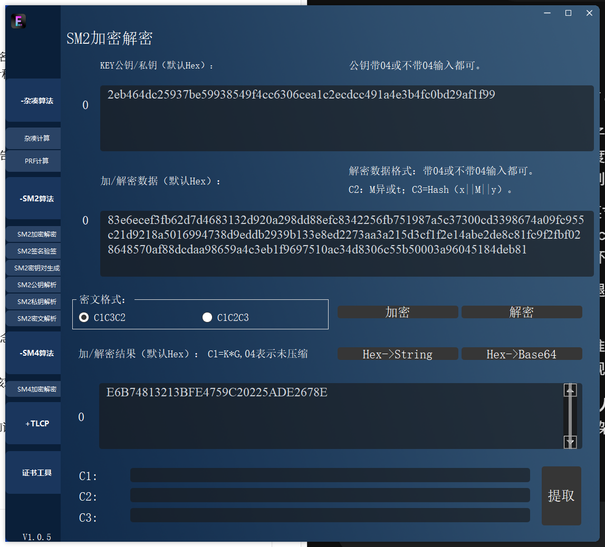
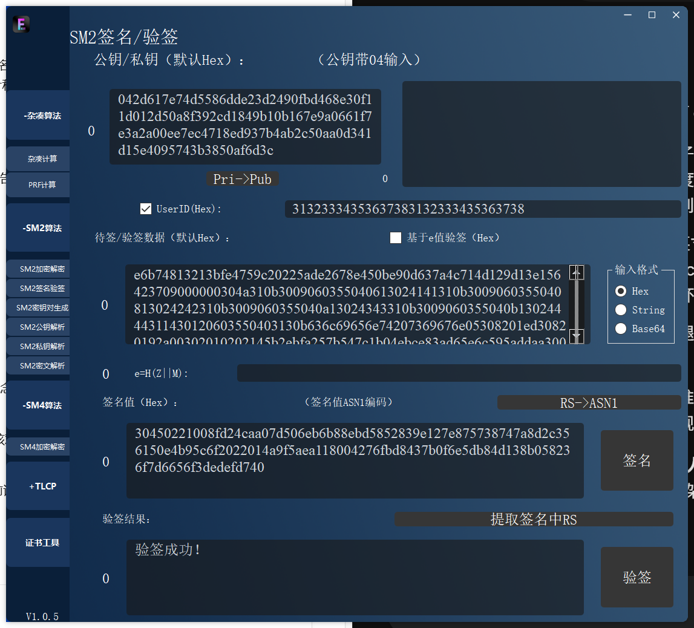
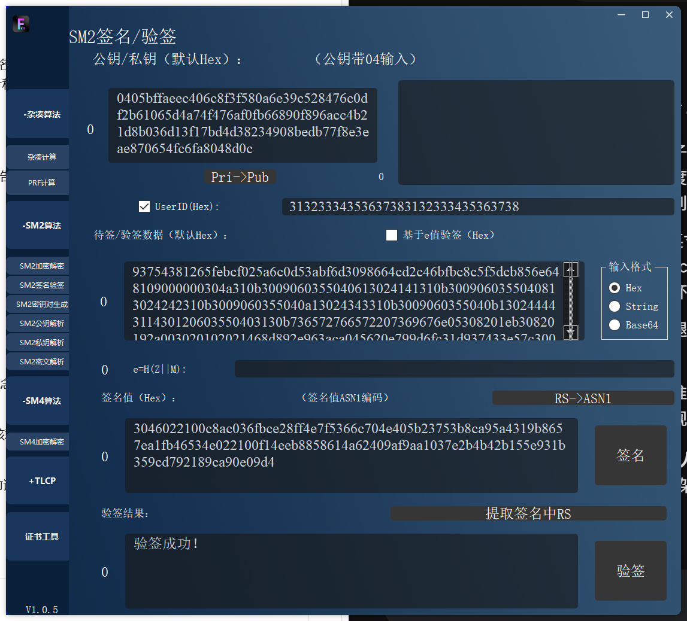
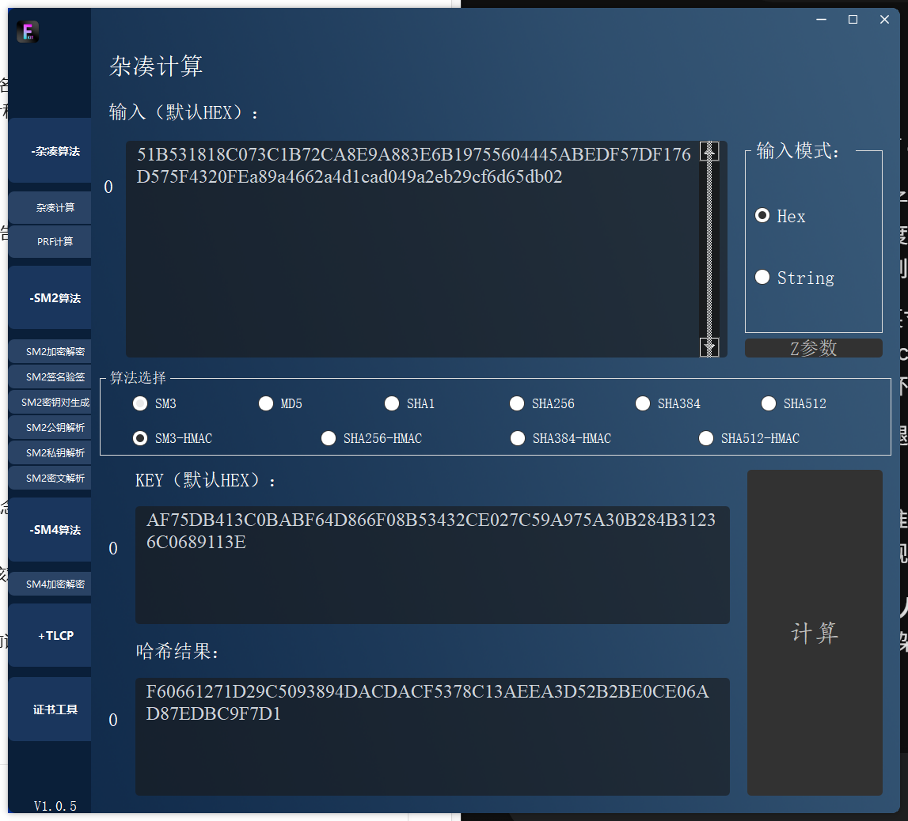
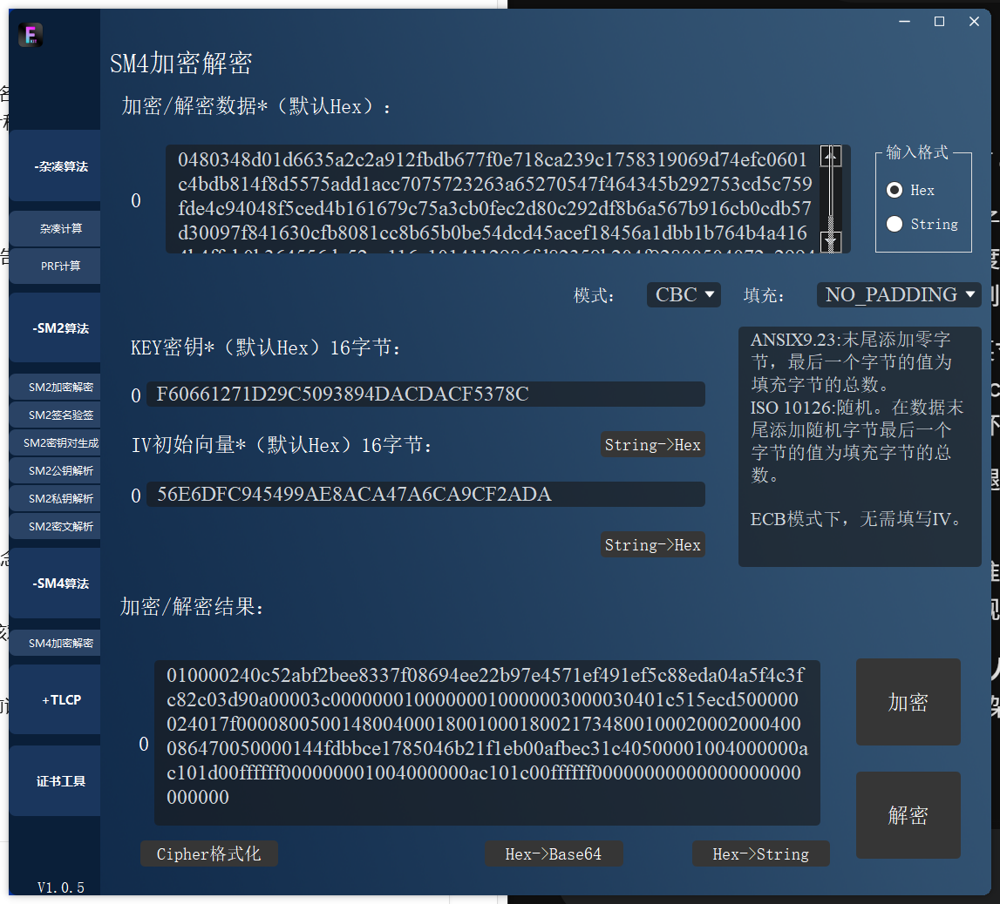

# IPSec协议验证实验报告

**课程：信息安全系统设计**  
**学号：20241328　姓名：蔡贸俊　班级：2413**

## 一、实验任务与验证思路

本次作业包括两部分：第一部分使用课程附件中的密码协议验证工具复核 IPSec 协议数据；第二部分使用 OpenSSL 命令独立完成同一组数据的验证。我按“解密关键数据 → 验证双方签名 → 派生工作密钥 → 校验主模式 HASH → 解密快速模式并验证完整性”的顺序进行实验。

### 1.1 材料检查

- 附件为 `密码协议验证工具-rocedu (1).zip`，解压后包含 `Fdog-Base.exe` 及其运行库，界面显示版本 **V1.0.5**。
- 题目给出的在线链接实际显示《（美化）ch03 密码技术-10--密码协议验证IPSec-2.pptx》，共 **61 页**。我逐页读取了其中的文字和关键页面，依据第 9—59 页给出的样例值开展运算复核。
- 本地附件未包含课件提到的 `left.pcapng`、`left_enc.key` 和 `right_enc.key`。因此本报告的密文、签名、公钥及私钥数值来自课件；没有将课件里的 Wireshark 截图作为自己的抓包结果。
- 课件已提供双方签名原文、签名值、公钥、派生公式及快速模式前两包密文，可以完成本报告的密码运算验证。视频未读取，不作为本报告的事实依据。

### 1.2 任务与证据对应

| 作业内容 | 本次操作 | 实际证据 |
|---|---|---|
| 使用附件工具验证（79 分项） | SM2 解密及双方验签，SM3/HMAC 派生，SM4-CBC 解密和 HASH 复核 | 20 项工具运算记录、20 张对应窗口截图 |
| 使用 OpenSSL 验证（20 分加分项） | 用 `pkeyutl`、`dgst`、`enc` 独立重算，并执行篡改对照 | 26 项检查通过，完整命令、退出码、二进制输入输出 |
| 提交验证过程 | 记录输入来源、步骤、结果、对比与结论 | 本 Markdown 及由其转换的 PDF |

## 二、实验环境与基本原理

### 2.1 实际环境

| 项目 | 配置 |
|---|---|
| 操作系统 | Windows 10，10.0.19045，AMD64 |
| 附件工具 | Fdog-Base / Fdog-Kit-Zookeeper，V1.0.5（同一运行窗口可能显示不同标题） |
| 命令行密码工具 | OpenSSL 3.5.9 29 Sep 2026 (Library: OpenSSL 3.5.9 29 Sep 2026) |
| OpenSSL 程序路径 | `C:\Program Files\Git\usr\bin\openssl.exe` |
| 辅助脚本 | Python 3.12.10，用于十六进制转字节、ASN.1 编码、调用命令及整理输出 |
| 密码算法 | SM2、SM3、HMAC-SM3、SM4-CBC |

OpenSSL 部分没有调用附件工具或其 DLL；密码运算均由独立的 OpenSSL 可执行程序完成。Python 没有重新实现 SM2、SM3、HMAC 或 SM4。

### 2.2 两个阶段及符号

课件采用国密 IPSec VPN 的两阶段协商示例：第一阶段主模式用于身份鉴别与工作密钥协商，建立 ISAKMP SA；第二阶段快速模式在第一阶段密钥保护下协商 IPSec SA。它与通用 IKEv2 的消息流程不同，本次按课件给定公式验证。

- `i` 表示发起方，`r` 表示响应方；`Ni`、`Nr` 是第一阶段 Nonce。
- `SKi`、`SKr` 是课件样例中的密钥材料，不能和最终 ESP 会话密钥混同。
- `CKY-I`、`CKY-R` 分别为 8 字节 Cookie；`MsgID` 为 4 字节消息标识。
- `X || Y` 表示**字节串拼接**，不是把十六进制文本当 ASCII 字符计算。
- `载荷_b` 表示去掉 4 字节 ISAKMP 通用载荷头后的主体。ID 主体中身份类型、协议和端口字段仍需保留。
- 本例 `HASH = SM3`，`PRF(K,M) = HMAC-SM3(K,M)`。附件工具应使用“杂凑计算 → SM3-HMAC”，不能将另一个面向 `P_hash` 的“PRF计算”页面直接套用到本例。

## 三、使用附件工具完成验证

### 3.1 准备输入与 SM2 密文格式

我解压附件并启动 `Fdog-Base.exe`。工具主要提供密码运算页面，因此把课件中的载荷数据按其对应算法逐项输入。

第一阶段发起方私钥（课件第 9 页）：

```text
2eb464dc25937be59938549f4cc6306cea1c2ecdcc491a4e3b4fc0bd29af1f99
```

课件第 12 页的 SKi 密文由 ASN.1 的 `X、Y、Hash、C` 四部分组成。工具的 C1C3C2 输入采用 `X || Y || C3 || C2`，先去掉 ASN.1 标签和长度；坐标按 32 字节表示，ASN.1 INTEGER 的符号补零不属于坐标。原始拼接值为：

```text
83e6ecef3fb62d7d4683132d920a298dd88efc8342256fb751987a5c37300cd3
398674a09fc955c21d9218a5016994738d9eddb2939b133e8ed2273aa3a215d3
cf1f2e14abe2de8c81fc9f2fbf028648570af88dcdaa98659a4c3eb1f9697510
ac34d8306c55b50003a96045184deb81
```


### 3.2 解密 SKi

1. 进入“SM2算法 → SM2加密解密”。
2. KEY 输入上面的 32 字节私钥。
3. 数据输入上面的密文，选择 **C1C3C2**，点击“解密”。

工具输出：

```text
e6b74813213bfe4759c20225ade2678e
```

结果与课件第 13 页的 `SKi` 一致，长度为 16 字节。



*图1　SM2 解密得到 SKi（本次附件工具窗口原始截图）*


### 3.3 解密 Ni 与 IDi

进入“SM4算法 → SM4加密解密”，输入编码选 Hex，模式选 CBC，填充选 **NO_PADDING**，先保留所有解密字节，再依据协议字段长度区分主体和尾部填充。

**（1）Ni：**密钥为 `SKi`，IV 为 16 字节零，密文来自第 14 页：

```text
a73cb7e86cc9b2020ecb43baa4e96cf8fb83d3a176a3e11b618206b32b958c69
```

完整解密结果：

```text
450be90d637a4c714d129d13e15642370000000000000000000000000000000f
```

按课件取前 16 字节作为 Ni：`450be90d637a4c714d129d13e1564237`；后 16 字节为 `00 × 15 || 0f`，保留在原始记录中。不能把该尾部当成 PKCS7 的 16 个 `10`。

**（2）IDi：**仍使用 `SKi`，IV 改为 **Ni 密文的最后一个分组**：`fb83d3a176a3e11b618206b32b958c69`。输入第 16 页的 96 字节密文：

```text
eff5aaaddbce5efb2d9daca6f1de48c88096f24ada20e090aa45dc2e46a90517
140fe404e0fa5c362423b9559a7dccb08d95ed049d05bf40fbe654ba7d0fae70
a583343b9cb2a417d66032ca9a786ff901f6987c86bf733851bf8a46ea92a3ef
```

解密后取前 80 字节作为 IDi 主体：

```text
09000000304a310b3009060355040613024141310b3009060355040813024242
310b3009060355040a13024343310b3009060355040b13024444311430120603
550403130b636c69656e74207369676e
```

前四字节 `09000000` 仍属于 ID 主体；后续为身份标识内容，末尾可读字符串为 `client sign`。余下 16 字节为 `00 × 15 || 0f`，不参加签名原文拼接。

### 3.4 验证双方 SM2 签名

发起方的签名原文为：

```text
Mi = SKi || Ni || IDi_b || CERT_enc_i
```

其中证书载荷主体 `CERT_enc_i` 为 **1 字节证书编码 05 + DER 证书**，保留 `05`，不加入其 4 字节通用载荷头。Mi 总长 **610 字节**。响应方按同样方法拼接 `Mr = SKr || Nr || IDr_b || CERT_enc_r`，总长 **608 字节**。

操作如下：

1. 打开“SM2签名验签”，公钥输入 `04 || X || Y`，不是证书的完整编码。
2. 输入对应的完整签名原文，编码选 Hex。
3. 签名的原始值是 `r || s`，各 32 字节；转换为 `SEQUENCE(INTEGER r, INTEGER s)` 后输入签名框。工具也提供“RS→ASN1”转换按钮。
4. 勾选 UserID，使用十六进制 `31323334353637383132333435363738`，对应字符串 `1234567812345678`。
5. 不勾选“基于 e 值验签”，点击“验签”。

| 项目 | 发起方 | 响应方 |
|---|---|---|
| 签名公钥长度 | 65 字节（含 04） | 65 字节（含 04） |
| 原始签名长度 | 64 字节 | 64 字节 |
| 签名原文长度 | 610 字节 | 608 字节 |
| 工具实际结果 | 验签成功！ | 验签成功！ |

完整公钥、原始签名及 Mi、Mr 见附录 A，所有字节也保存在 `data/vectors.json` 中。



*图2　发起方签名验证成功（本次附件工具窗口原始截图）*




*图3　响应方签名验证成功（本次附件工具窗口原始截图）*

这表明课件给出的两条签名与相应公钥、UserID 及消息内容相匹配。本步骤没有验证 CA 信任链和证书撤销状态。

### 3.5 派生第一阶段工作密钥

我在“杂凑计算”中选择 Hex。普通摘要选择 SM3；PRF 选择 **SM3-HMAC**，KEY 填密钥，输入框填消息。

基础输入为：

```text
Ni = 450be90d637a4c714d129d13e1564237
Nr = 098664cd2c46bfbc8c5f5dcb856e6481
CKY-I = a89a4662a4d1cad0
CKY-R = 49a2eb29cf6d65db
```

按课件第 28 页顺序计算：

```text
H = SM3(Ni || Nr)
SKEYID   = HMAC-SM3(H, CKY-I || CKY-R)
SKEYID_d = HMAC-SM3(SKEYID, CKY-I || CKY-R || 00)
SKEYID_a = HMAC-SM3(SKEYID, SKEYID_d || CKY-I || CKY-R || 01)
E_full   = HMAC-SM3(SKEYID, SKEYID_a || CKY-I || CKY-R || 02)
```

末尾 `00、01、02` 各是**一个字节**，不是字符“0”“1”“2”。本次输出如下：

**H：**

```text
83fddf2b5dc8bd853c343ee68f780cfaf2e37fdde3998da2c76a4b368816e972
```

**SKEYID：**

```text
af75db413c0babf64d866f08b53432ce027c59a975a30b284b31236c0689113e
```

**SKEYID_d：**

```text
d07385874bd72fa3ec6d42714e643a94de6644d24f2f50239892f8ef478293e7
```

**SKEYID_a：**

```text
51b531818c073c1b72ca8e9a883e6b19755604445abedf57df176d575f4320fe
```

**E_full：**

```text
f60661271d29c5093894dacdacf5378c13aeea3d52b2be0ce06ad87edbc9f7d1
```

SM4 密钥只取 E_full 的前 16 字节：`f60661271d29c5093894dacdacf5378c`。虽然课件第 34 页还展示了派生结果后半段，但消息 5、6 的实际 IV 按第 36 页的 `SM3(SKi || SKr)` 另算，不能直接用 E_full 的后 16 字节代替。



*图4　使用 SM3-HMAC 计算 E_full（本次附件工具窗口原始截图）*


### 3.6 解密并独立重算 HASHi、HASHr

先计算 `SM3(SKi || SKr)`，结果为：

```text
de788aa1e41303baf97136e86f82f2fc05fd904df03879c49c1e1a9a868b0e1a
```

取前 16 字节 `de788aa1e41303baf97136e86f82f2fc` 作为 HASHi 加密载荷的 IV；解密 HASHr 时，IV 为 HASHi 密文的最后 16 字节 `b958be5fa74277fc91b3bfd3d1cbf7e0`。均使用 SM4-CBC、前述 16 字节密钥、NO_PADDING。

解密后，两条载荷均为 **4 字节通用头 + 32 字节 HASH + 12 字节零填充**：

```text
HASHi 载荷头：00 00 00 24
HASHr 载荷头：00 00 00 24
0x0024 = 36 = 4 + 32
```

因此不能直接把完整 48 字节明文与 32 字节 HMAC 输出比较。

再按下式独立重算：

```text
HASHi = HMAC-SM3(SKEYID, CKY-I || CKY-R || SAi_b || IDi_b)
HASHr = HMAC-SM3(SKEYID, CKY-R || CKY-I || SAr_b || IDr_b)
```

本例 SAi_b 与 SAr_b 相同，都是 48 字节：

```text
0000000100000001000000280001000100000020010100008001007f80020014
8003000a80140002800b0001800c3de0
```

得到：

**HASHi：**

```text
5855a82383911acace237a72d2c6427aa18d552fc4d80d13288104a7f9da2f3c
```

**HASHr：**

```text
4146700c999eb6b4ce92891881b8ec69c013bf83062b885372f2dfddfafe4ea6
```

两者分别与解密载荷的 32 字节 HASH 主体完全一致，也与课件第 44、48 页一致。这一步把前面的密钥派生、Cookie 顺序、SA 和身份载荷联系起来，而不只是“成功解出一段数据”。

### 3.7 第二阶段快速模式解密

第一包 IV 按课件第 49—51 页计算：

```text
MsgID = cc2d2221
第一阶段最后密文分组 = d92048953a172891b194012f8db5f7b0
IV1 = SM3(第一阶段最后密文分组 || MsgID) 的前16字节
```

完整摘要为：

```text
56e6dfc945499ae8aca47a6ca9cf2ada005ac24e502d2ad621591efd5d57bdbe
```

因此 `IV1 = 56e6dfc945499ae8aca47a6ca9cf2ada`。以同一个 SKEYID_e 的前 16 字节为密钥，解密快速模式第一包；第二包 IV 改为**第一包密文最后一组**：`359b204f92800504072e2994af771b88`。

两包密文均为 160 字节，解密结果均含 148 字节有效载荷和 12 字节零填充。第一包完整明文如下：

```text
010000240c52abf2bee8337f08694ee22b97e4571ef491ef5c88eda04a5f4c3f
c82c03d90a00003c00000001000000010000003000030401c515ecd500000024
017f000080050014800400018001000180021734800100020002000400086470
050000144fdbbce1785046b21f1eb00afbec31c40500001004000000ac101d00
ffffff000000001004000000ac101c00ffffff00000000000000000000000000
```




*图5　快速模式第一包 SM4-CBC 解密（本次附件工具窗口原始截图）*

我按 Next Payload 与 Length 逐个拆分，而不是仅根据可读字符串判断解密是否正确：

| 偏移（字节） | 当前载荷 | 长度（含通用头） | 下一载荷 |
|---|---|---|---|
| 0 | HASH | 36 | SA（1） |
| 36 | SA | 60 | Nonce（10） |
| 96 | Nonce | 20 | ID（5） |
| 116 | IDi | 16 | IDr（5） |
| 132 | IDr | 16 | 无（0） |
| 148 | 零填充 | 12 | — |

从两包明文可解析到：

| 字段 | 第一包 | 第二包 |
|---|---|---|
| 协议号 | 3，ESP | 3，ESP |
| SPI | `c515ecd5` | `c713ad06` |
| 变换标识 | `0x7f`，课件样例对应 SM4 | 同左 |
| 鉴别属性 | `80050014`，课件对应 HMAC-SM3 | 同左 |
| 封装模式 | `80040001`，隧道模式 | 同左 |
| 秒生存期 | `0x1734 = 5940` 秒 | 同左 |
| KB 生存期 | `0x00086470 = 550000` KB | 同左 |
| Nonce | `4fdbbce1785046b21f1eb00afbec31c4` | `106bcaa925dc5b6d994efc88369d6059` |
| IDi 子网 | `172.16.29.0/24` | 同左 |
| IDr 子网 | `172.16.28.0/24` | 同左 |

变换编号按课件历史样例解析，不将样例中的 `0x7f` 直接当成所有版本的标准编号。

### 3.8 快速模式完整性复核

进一步计算前两包 HASH，作为对“解密后结构合理”的补充验证：

```text
HASH(1) = HMAC-SM3(SKEYID_a, MsgID || M1_after_HASH)
HASH(2) = HMAC-SM3(SKEYID_a, MsgID || Ni2_b || M2_after_HASH)
```

这里 `Ni2_b` 是第二阶段第一包中 16 字节的 Nonce，不能误用第一阶段 Ni；`M_after_HASH` 包含后续载荷各自的通用头，排除 HASH 载荷及尾部填充，本例为明文偏移 `[36,148)`。

**HASH(1)：**

```text
0c52abf2bee8337f08694ee22b97e4571ef491ef5c88eda04a5f4c3fc82c03d9
```

**HASH(2)：**

```text
d90aad574e561b98e0fd9136cc217e7e4c8300cf8c3829aa2c650e8de73e7c21
```

两项均与解密包内的 HASH 一致。附件工具共完成 **20 项**运算，逐项输出与独立 OpenSSL 结果一致；完整输入、输出和判定保存在 `logs/attachment-tool-verification.txt`。

## 四、加分项目：使用 OpenSSL 命令独立验证

### 4.1 数据准备及复现入口

我另用 OpenSSL 对**同一组课件输入**进行验证。脚本 `src/verify_openssl.py` 只调用独立 OpenSSL 程序；即使附件工具未启动，仍可完成全部命令行检查。

本节命令均在实验目录运行。Windows PowerShell 可先指定程序位置：

```powershell
$ossl = "C:\Program Files\Git\usr\bin\openssl.exe"
& $ossl version
```

实际版本输出：

```text
OpenSSL 3.5.9 29 Sep 2026 (Library: OpenSSL 3.5.9 29 Sep 2026)
```

十六进制输入先转换成二进制文件，不能直接把十六进制文本文件传给 `dgst`。完整复现命令为：

```powershell
$env:OPENSSL_EXE = "C:\Program Files\Git\usr\bin\openssl.exe"
python .\src\verify_openssl.py
```

其中 `python` 指可用的 Python 3；本机实际用隔离的 Python 3.12.10 解释器执行。此脚本使用 Python 标准库，不依赖 GUI 自动化库或密码库。

### 4.2 转换格式并用 SM2 解密

OpenSSL 的 SM2 解密输入需要 ASN.1 DER，而附件工具接受裸 C1C3C2。因此脚本将同一份密文包装为：

```text
SEQUENCE {
  INTEGER xCoordinate,
  INTEGER yCoordinate,
  OCTET STRING C3,
  OCTET STRING C2
}
```

脚本还将课件私钥标量包装为带 SM2 曲线 OID `1.2.156.10197.1.301` 的 ECPrivateKey，再由 `pkey` 转成 PEM。这里是**编码重建**，没有声称读取了缺失的原始 `.key` 文件。

手动复现命令：

```powershell
& $ossl pkey -inform DER -in data/enc_i.der -out data/enc_i.pem
& $ossl pkeyutl -decrypt -inkey data/enc_i.pem -in data/ski.der -out data/ski.bin
```

本次输出字节的十六进制表示为 `e6b74813213bfe4759c20225ade2678e`，与附件工具、课件均一致。

### 4.3 使用 SM4-CBC 解密

以 Ni 解密为例，手动等效命令为：

```powershell
& $ossl enc -d -sm4-cbc -K e6b74813213bfe4759c20225ade2678e `
  -iv 00000000000000000000000000000000 -nopad `
  -in data/ni_decrypted.enc -out data/ni-manual.bin
```

`-K` 和 `-iv` 接收十六进制参数，`-nopad` 禁止默认 PKCS7 去填充；它不是“不产生明文尾部”，而是让协议填充原样保留。结果与第三节的完整 Ni 明文逐字节一致。

IDi、HASHi、HASHr 和快速模式两包使用相同的 `enc -d -sm4-cbc -nopad` 方式，只按第三节替换输入、密钥和 IV。完整命令及输出见 `logs/openssl-verification.txt`。

### 4.4 使用 SM2 验证双方签名

脚本将 `04 || X || Y` 包装成 SubjectPublicKeyInfo DER，将 `r || s` 包装成 DER 签名。若 INTEGER 的最高位为 1，DER 编码需添加符号用 `00`；不能简单地把 64 字节原始签名直接交给 OpenSSL。

发起方命令：

```powershell
& $ossl pkeyutl -verify -pubin -keyform DER `
  -inkey data/sig_i_pub.der -rawin -digest sm3 `
  -pkeyopt distid:1234567812345678 `
  -in data/signed_i.bin -sigfile data/sig_i.der
```

响应方命令：

```powershell
& $ossl pkeyutl -verify -pubin -keyform DER `
  -inkey data/sig_r_pub.der -rawin -digest sm3 `
  -pkeyopt distid:1234567812345678 `
  -in data/signed_r.bin -sigfile data/sig_r.der
```

本次两条命令的实际输出均为：

```text
Signature Verified Successfully
exit=0
```

其中 `-rawin -digest sm3` 表示输入的是待签消息原文；OpenSSL 按 SM2 规则结合 UserID 计算相关摘要。不能先对原文普通 SM3 一次，再把摘要当“原文”重复哈希。

### 4.5 使用 SM3 与 HMAC-SM3 派生密钥

普通 SM3：

```powershell
& $ossl dgst -sm3 -binary data/nonce_hash.bin
```

其二进制输出在日志中显示为：

```text
83fddf2b5dc8bd853c343ee68f780cfaf2e37fdde3998da2c76a4b368816e972
```

计算 SKEYID 的命令：

```powershell
& $ossl dgst -sm3 -mac HMAC `
  -macopt hexkey:83fddf2b5dc8bd853c343ee68f780cfaf2e37fdde3998da2c76a4b368816e972 `
  -binary data/skeyid.bin
```

此处 `data/skeyid.bin` 是 **Cookie 拼接的输入文件**，不是已经派生出的 SKEYID。计算结果保存为 `data/skeyid.sm3`。后续密钥和 HASH 使用同样命令形式：KEY 换成相应密钥值，输入文件换成按公式拼好的字节文件。

| 运算 | KEY | 输入文件（文件内容） | 与附件工具对比 |
|---|---|---|---|
| SKEYID | SM3(Ni\|\|Nr) | `skeyid.bin`（两 Cookie） | 相同 |
| SKEYID_d | SKEYID | `skeyid_d.bin`（两 Cookie\|\|00） | 相同 |
| SKEYID_a | SKEYID | `skeyid_a.bin`（d\|\|两 Cookie\|\|01） | 相同 |
| E_full | SKEYID | `skeyid_e_full.bin`（a\|\|两 Cookie\|\|02） | 相同 |
| HASHi、HASHr | SKEYID | `hashi.bin`、`hashr.bin` | 相同，且等于包内 HASH |
| HASH(1)、HASH(2) | SKEYID_a | `quick_hash1.bin`、`quick_hash2.bin` | 相同，且等于包内 HASH |

表内文件均位于 `data/`；输出在同名 `.sm3` 文件中。带 `-binary` 的命令输出是二进制，脚本将其以 HEX 记录，不通过 PowerShell 文本重定向保存二进制。

### 4.6 篡改对照验证

为检查验签是否真正依赖输入内容，我分别把 Mi、Mr 的**第一个字节异或 01**，其余输入保持不变，再执行原来的验签命令：

| 检查 | 原始数据 | 修改一字节后 |
|---|---|---|
| 发起方 SM2 验签 | 成功，退出码 0 | 失败，退出码 1 |
| 响应方 SM2 验签 | 成功，退出码 0 | 失败，退出码 1 |
| 快速模式 HASH(1) | 等于第一包 HASH | 修改覆盖内容最后一字节后不相等 |

篡改后的 SM2 实际输出为 `Signature Verification Failure`。快速模式篡改后重算 HASH(1) 为：

```text
15aae52ea72e752eaf40f18f69b8e7e2b34da5ee9bd39533f72781fd979fb074
```

它与原始 `0c52abf2bee8337f08694ee22b97e4571ef491ef5c88eda04a5f4c3fc82c03d9` 不同。因此篡改会被签名或带密钥的摘要检出；单纯 CBC 解密本身不等同于完整性验证。

## 五、验证结果汇总

| 验证对象 | 附件工具 | OpenSSL / 解析结果 | 判断 |
|---|---|---|---|
| SKi | 解密为课件给定值 | 同值 | 一致 |
| Ni、IDi | 解密成功，保留尾部 | 逐字节一致 | 一致 |
| 发起方、响应方签名 | 均“验签成功！” | 两次退出码均为 0 | 一致 |
| SKEYID、d、a、e | 按 HMAC-SM3 顺序得到 | 独立命令重算同值 | 一致 |
| HASHi、HASHr | 解密值等于重算值 | 同时与课件值比较通过 | 一致 |
| 快速模式 IV | SM3 取前 16 字节 | 同值 | 一致 |
| 快速模式两包 | 解密得到载荷链 | 长度、Next Payload、零填充均正确 | 通过 |
| HASH(1)、HASH(2) | 与包内值相同 | 独立 HMAC 重算一致 | 通过 |
| 篡改消息 | — | 两次签名拒绝、一次 MAC 不匹配 | 符合预期 |

附件工具的 **20 项实际运算全部一致**；OpenSSL 脚本的 **26 项检查全部通过**。20 与 26 是各自脚本定义的运算项/检查项数量，不是额外的报文数量或评分承诺。

## 六、实验中遇到的问题与处理

### 6.1 默认 PKCS7 导致解密结果为空

最初附件工具使用默认填充时，SM4 解密没有得到预期结果。检查课件明文尾部后发现：Ni、IDi 尾部为 `00 × 15 || 0f`，主模式 HASH 和快速模式报文则包含零填充，不符合工具默认 PKCS7 的检查要求。我改为 **NO_PADDING**，并在 OpenSSL 中使用 `-nopad`，再次运行后六项 SM4 解密全部与独立结果一致。

处理原则是先保留原始解密字节，再按字段长度解释填充；不能为了让工具“去填充成功”而修改课件密文。

### 6.2 把裸 SM2 数据与 ASN.1 编码区分开

同样的密文和签名在两种工具中的输入格式不同。附件解密使用 C1C3C2，OpenSSL 解密使用 DER；签名的 `r||s` 需转换为两个 INTEGER 的 SEQUENCE。转换只改变外层编码，不改变密码学数值。

### 6.3 IV 和 HASH 输入范围不能混用

本次 IV 随阶段变化：Ni 用全零；IDi 用 Ni 的密文尾块；HASHi 用 `SM3(SKi||SKr)` 前 16 字节；HASHr 用 HASHi 密文尾块；快速模式第一包用“上一阶段密文尾块与 MsgID”的摘要，第二包用第一包密文尾块。只有按课件关系串联，才能同时满足解密和 MAC 校验。

第一阶段 `SA_b、ID_b` 去掉通用头；快速模式 `M_after_HASH` 保留后续载荷的通用头。两者的拼接范围不同，是本次复核中需要特别核对的地方。

## 七、实验结论

本次通过附件工具与 OpenSSL 两条路线，对课件样例完成了 SM2 解密、双方 SM2 签名、第一阶段工作密钥派生、HASHi/HASHr 以及第二阶段前两包的解密和完整性验证。不同工具的结果一致，篡改对照也能检出一字节修改，说明这组样例的密钥、消息与鉴别值之间具有一致的密码学关系。

本报告验证的是课件样例的密码运算和报文载荷关系。材料未提供原始 pcap、快速模式第三包和 ESP 业务数据，因此未宣称完成现场抓包、HASH(3) 核验、ESP 数据面测试或实际 VPN 隧道建立；证书链也未做完整信任验证。

## 八、参考资料

1. 娄嘉鹏，《信息安全系统设计：密码技术—密码协议验证IPSec》，云班课在线课件，共 61 页。重点使用第 9—59 页。题目提供的访问地址：[云班课课件](https://viewer.mosoteach.cn/viewer?token=620d79be4742bb6b4b30176fcd02010e&app_id=MTWEB&app_version=6.0.0&screenx=null&location=null)。
2. 课程附件 `密码协议验证工具-rocedu (1).zip`，本次实际运行 Fdog-Base V1.0.5。
3. OpenSSL 3.5 官方文档：[openssl-pkeyutl](https://docs.openssl.org/3.5/man1/openssl-pkeyutl/)，用于核对 SM2、`distid`、`rawin` 等参数。
4. OpenSSL 3.5 官方文档：[EVP_PKEY-SM2](https://docs.openssl.org/3.5/man7/EVP_PKEY-SM2/)，用于核对 SM2 UserID 与摘要机制。

## 附录 A：关键输入数据

以下数据均为课件样例的十六进制字节表示；换行仅用于排版，使用时拼接。完整密文和输出另见 `data/vectors.json`、`logs/openssl-results.json`。

### 发起方签名公钥（不含04）

```text
2d617e74d5586dde23d2490fbd468e30f11d012d50a8f392cd1849b10b167e9a
0661f7e3a2a00ee7ec4718ed937b4ab2c50aa0d341d15e4095743b3850af6d3c
```

### 发起方签名 r||s

```text
8fd24caa07d506eb6b88ebd5852839e127e875738747a8d2c356150e4b95c6f2
14a9f5aea118004276fbd8437b0f6e5db84d138b058236f7d6656f3dedefd740
```

### 响应方签名公钥（不含04）

```text
05bffaeec406c8f3f580a6e39c528476c0df2b61065d4a74f476af0fb66890f8
96acc4b21d8b036d13f17bd4d38234908bedb77f8e3eae870654fc6fa8048d0c
```

### 响应方签名 r||s

```text
c8ac036fbce28ff4e7f5366c704e405b23753b8ca95a4319b8657ea1fb46534e
f14eeb8858614a62409af9aa1037e2b4b42b155e931b359cd792189ca90e09d4
```

### 发起方完整签名原文 Mi（610字节）

```text
e6b74813213bfe4759c20225ade2678e450be90d637a4c714d129d13e1564237
09000000304a310b3009060355040613024141310b3009060355040813024242
310b3009060355040a13024343310b3009060355040b13024444311430120603
550403130b636c69656e74207369676e05308201ed30820192a0030201020214
5b2ebfa257b547c1b04ebce83ad65e6c595addaa300a06082a811ccf55018375
3045310b3009060355040613024141310b300906035504080c024242310b3009
060355040a0c024343310b3009060355040b0c024444310f300d06035504030c
067375622063613020170d3233303232323032333031345a180f323132333031
32393032333031345a3049310b3009060355040613024141310b300906035504
080c024242310b3009060355040a0c024343310b3009060355040b0c02444431
13301106035504030c0a636c69656e7420656e633059301306072a8648ce3d02
0106082a811ccf5501822d034200042920dde9348041de867e49a5caa1936d32
41f9b79cb5dcc5c6d59b31f8d88467b05b38505b101f7dbf242bcba73daf394c
f0879d3f0e8ec08739f1db00fa770ca35a305830090603551d1304023000300b
0603551d0f040403020338301d0603551d0e041604147cf13c4f768f4733a2ff
e2e259346b90cfb474a8301f0603551d23041830168014ac61eb22806259083e
96c8d17fce745c02af3c99300a06082a811ccf550183750349003046022100e2
131845079c82d4a4b09b4990b21bc4e281899b83b226c9916d5c5fee12139f02
2100e7d3e711561a7a0be92392ed9f94f63ca2aa899d9039611f4472488bf145
65ea
```

### 响应方完整签名原文 Mr（608字节）

```text
93754381265febcf025a6c0d53abf6d3098664cd2c46bfbc8c5f5dcb856e6481
09000000304a310b3009060355040613024141310b3009060355040813024242
310b3009060355040a13024343310b3009060355040b13024444311430120603
550403130b736572766572207369676e05308201eb30820192a0030201020214
68d892e963aca045620e799d6fc31d937433e57c300a06082a811ccf55018375
3045310b3009060355040613024141310b300906035504080c024242310b3009
060355040a0c024343310b3009060355040b0c024444310f300d06035504030c
067375622063613020170d3233303232323032333031345a180f323132333031
32393032333031345a3049310b3009060355040613024141310b300906035504
080c024242310b3009060355040a0c024343310b3009060355040b0c02444431
13301106035504030c0a73657276657220656e633059301306072a8648ce3d02
0106082a811ccf5501822d034200047dbea54543458172bd3b688e509c2df545
86ace00b58ec941499f94a50a58c675d6f9adaff089e8137a76343acd2f35ca3
0a8a5ccf81b7cdce5266a016b9e364a35a305830090603551d1304023000300b
0603551d0f040403020338301d0603551d0e0416041467a5add59476e05a9c5e
56b8860ff13b28eeec54301f0603551d23041830168014ac61eb22806259083e
96c8d17fce745c02af3c99300a06082a811ccf55018375034700304402204759
3579c4adec8db7df98c4aae1661c1139a5ef1293f22a3aa412d09becd6e60220
6e57301d177946956fd39cb5ac603902cd17c7517ed8941ecc985ea7db6958c8
```

### HASHi 密文（48字节）

```text
c60c2e7689fa1519256ec690bbfb7d6380a52de3d51ce8fb1ac5923a84ceac86
b958be5fa74277fc91b3bfd3d1cbf7e0
```

### HASHr 密文（48字节）

```text
dd55ad19832211a7909550c3472615c55feddb949b5ee01f9cfe6d9e228e3a1d
d92048953a172891b194012f8db5f7b0
```

### 快速模式第一包密文（160字节）

```text
0480348d01d6635a2c2a912fbdb677f0e718ca239c1758319069d74efc0601c4
bdb814f8d5575add1acc7075723263a65270547f464345b292753cd5c759fde4
c94048f5ced4b161679c75a3cb0fec2d80c292df8b6a567b916cb0cdb57d3009
7f841630cfb8081cc8b65b0be54dcd45acef18456a1dbb1b764b4a4164b4ffab
0b364556de52ec116c1014112986fd82359b204f92800504072e2994af771b88
```

### 快速模式第二包密文（160字节）

```text
49813dfd83a4c3c3bf2950290904fc4237c90e5e45e4991a60336a91ee6848de
0ca5964fbb5af6f0aa607ebcc8188e9774a8ac79f1f93b1a72140625c3588eea
7e1e4b137783c948e9bd7a060f8d36821b5198c7e3eb41a5ad4e3f30acf978f8
0930e47a79e3ddae43fb9d1463c6dbcb45ad9d37ead1eb54fbcf39058a9e9c39
f7a9c43c6c1aecc5a1a58522abd5960920f20261bf78e32847d2f84e7f4cbdb2
```

## 附录 B：实验文件与复现说明

| 文件或目录 | 用途 |
|---|---|
| `data/vectors.json` | 课件输入的原始十六进制数值 |
| `data/` 中 DER、PEM、BIN、ENC、PLAIN、SM3 文件 | OpenSSL 实际输入、输出和重编码数据 |
| `src/verify_openssl.py` | 独立执行所有命令行检查，只依赖 Python 标准库与 OpenSSL |
| `src/verify_attachment_gui.py` | 在已经打开的附件工具上填入数据、读取输出并保存截图 |
| `logs/openssl-verification.txt` | OpenSSL 完整命令、退出码、输出 |
| `logs/openssl-results.json` | 26 项检查及计算结果 |
| `logs/attachment-tool-verification.txt` | 20 项附件工具运算输入和输出 |
| `images/` | 每项工具运算对应的原始窗口截图 |
| `references/` | 在线课件读取记录及关键页面留存 |

复现 OpenSSL 部分时保留 `src/` 和 `data/` 的相对位置，设置 `OPENSSL_EXE` 后运行 `python src/verify_openssl.py`。复现 GUI 部分还需安装 pywinauto、Pillow，手动启动附件工具，展开杂凑算法、SM2算法、SM4算法菜单，再运行 `python src/verify_attachment_gui.py`。GUI 复核对照文件为本次独立 OpenSSL 结果。

