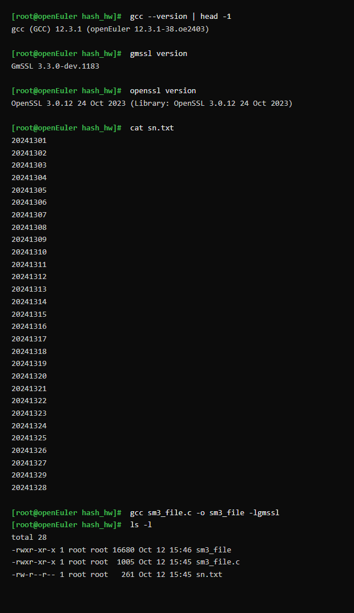
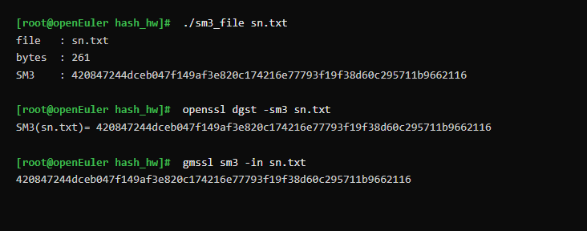

# 使用 GmSSL 编程计算文件 Hash 值

**学号**：20241328　**姓名**：蔡贸俊

---

## 一、实验目标

1. 在 openEuler 中生成一个文件 `sn.txt`，内容为全班同学的 8 位学号，且**把本人学号 20241328 排在最后**。
2. 使用 **GmSSL** 的 SM3 接口编写 C 程序，计算 `sn.txt` 的 Hash（杂凑）值。
3. 使用 **OpenSSL 命令**验证程序计算结果的正确性。

## 二、实验环境

| 项目 | 版本信息 |
|---|---|
| 操作系统 | openEuler 24.03 LTS（WSL2） |
| 编译器 | gcc (GCC) 12.3.1 (openEuler 12.3.1-38.oe2403) |
| 密码库（编程用） | GmSSL 3.3.0-dev.1183（/usr/local） |
| 密码库（验证用） | OpenSSL 3.0.12 24 Oct 2023 |

## 三、实践过程（文本记录）

### 3.1 生成 sn.txt

本班学号范围是 20241301～20241329（共 29 人）。为了让本人学号 20241328 排在最后，先生成 20241301～20241329 并剔除 20241328，再把 20241328 追加到文件末尾：

```bash
seq 20241301 20241329 | grep -v 20241328 > sn.txt
echo 20241328 >> sn.txt
```

生成后的 `sn.txt` 内容（共 29 行）：

```text
20241301
20241302
20241303
20241304
20241305
20241306
20241307
20241308
20241309
20241310
20241311
20241312
20241313
20241314
20241315
20241316
20241317
20241318
20241319
20241320
20241321
20241322
20241323
20241324
20241325
20241326
20241327
20241329
20241328
```

### 3.2 编写 GmSSL 程序 sm3_file.c

使用 GmSSL 的流式 SM3 接口 `sm3_init / sm3_update / sm3_finish` 对文件分块读取并计算摘要，最后按十六进制打印：

```c
/*
 * sm3_file.c —— 使用 GmSSL 计算文件 sn.txt 的 SM3 杂凑值
 *
 * 编译： gcc sm3_file.c -o sm3_file -lgmssl
 * 运行： ./sm3_file sn.txt
 */
#include <stdio.h>
#include <stdint.h>
#include <stdlib.h>
#include <gmssl/sm3.h>

#define BUFSIZE 4096

static void print_hex(const uint8_t *buf, size_t len)
{
	size_t i;
	for (i = 0; i < len; i++) {
		printf("%02x", buf[i]);
	}
	printf("\n");
}

int main(int argc, char **argv)
{
	const char *path = (argc > 1) ? argv[1] : "sn.txt";
	FILE *fp;
	SM3_CTX ctx;
	uint8_t dgst[SM3_DIGEST_SIZE];
	uint8_t buf[BUFSIZE];
	size_t n;
	long total = 0;

	fp = fopen(path, "rb");
	if (!fp) {
		fprintf(stderr, "cannot open file: %s\n", path);
		return 1;
	}

	sm3_init(&ctx);
	while ((n = fread(buf, 1, sizeof(buf), fp)) > 0) {
		sm3_update(&ctx, buf, n);
		total += (long)n;
	}
	fclose(fp);
	sm3_finish(&ctx, dgst);

	printf("file   : %s\n", path);
	printf("bytes  : %ld\n", total);
	printf("SM3    : ");
	print_hex(dgst, SM3_DIGEST_SIZE);

	return 0;
}
```

### 3.3 编译与运行环境检查

用 gcc 链接 GmSSL 动态库编译（`-lgmssl`）：

```bash
gcc sm3_file.c -o sm3_file -lgmssl
ls -l
```

编译过程与文件准备（含 sn.txt 内容、编译命令、生成的可执行文件）截图如下：



### 3.4 运行程序计算 Hash

```bash
./sm3_file sn.txt
```

程序读取 `sn.txt`（261 字节 = 29 行 × 9 字节），计算并输出 SM3 摘要：

```text
file   : sn.txt
bytes  : 261
SM3    : 420847244dceb047f149af3e820c174216e77793f19f38d60c295711b9662116
```

## 四、使用 OpenSSL 命令验证（4 分）

用 OpenSSL 自带的 `dgst` 命令对同一个文件计算 SM3，与 GmSSL 程序结果比对：

```bash
openssl dgst -sm3 sn.txt
```

输出：

```text
SM3(sn.txt)= 420847244dceb047f149af3e820c174216e77793f19f38d60c295711b9662116
```

运行与验证的整体截图（程序输出 + OpenSSL 结果 + GmSSL 命令行结果）：



**比对结论**：GmSSL 编程结果与 OpenSSL 命令结果**完全一致**，均为

```text
420847244dceb047f149af3e820c174216e77793f19f38d60c295711b9662116
```

为进一步交叉验证，又用 GmSSL 命令行 `gmssl sm3 -in sn.txt` 计算了一次，结果同样一致，证明程序实现正确。

## 五、AI 问答过程（文本记录）

> 使用的 AI 工具：opencode（接入 DeepSeek API）

**我**：我要用 GmSSL 的 C 接口对一个文件算 SM3，应该调用哪些函数？函数原型是什么？

**AI**：GmSSL 3.x 的 SM3 接口在头文件 `<gmssl/sm3.h>` 中，核心是三个流式函数：`void sm3_init(SM3_CTX *ctx);`、`void sm3_update(SM3_CTX *ctx, const uint8_t *data, size_t datalen);`、`void sm3_finish(SM3_CTX *ctx, uint8_t dgst[SM3_DIGEST_SIZE]);`。其中 `SM3_DIGEST_SIZE` 是 32（字节）。典型用法是 `sm3_init` 初始化、循环 `sm3_update` 喂数据、最后 `sm3_finish` 取出 32 字节摘要。

**我**：为什么推荐流式（init/update/finish）而不是一次性把一个函数算完？文件不大的话有区别吗？

**AI**：SM3 是分组迭代的杂凑算法，流式接口的好处是内存占用恒定——不管文件多大，只要一块缓冲区反复 `update` 即可，非常适合大文件；一次性接口本质也是内部把所有数据喂一遍。对 `sn.txt` 这种小文件两者结果完全相同，但养成流式的写法更通用。

**我**：编译时怎么链接 GmSSL？

**AI**：GmSSL 装到 `/usr/local` 后，头文件在 `/usr/local/include/gmssl/`、动态库在 `/usr/local/lib/libgmssl.so.3`。gcc 默认会搜索 `/usr/local/include` 和 `/usr/local/lib`，所以直接 `gcc sm3_file.c -o sm3_file -lgmssl` 即可；若运行时报找不到 `libgmssl.so.3`，再把 `/usr/local/lib` 加入 `LD_LIBRARY_PATH`（或用 `ldconfig` 注册）。

**我**：那怎么确认我程序的 Hash 算对了？

**AI**：用不同实现交叉验证——用 OpenSSL 命令 `openssl dgst -sm3 sn.txt` 对同一文件再算一遍。只要输入完全相同，任一正确实现算出的 SM3 都是同一个值；两条结果一致就能确认你的程序没有读写错误或参数错误。

**我**：还有一个疑惑：为什么我用 `gmssl sm3 sn.txt` 会报 illegal option，而 OpenSSL 的写法却能直接接文件名？

**AI**：这是命令行参数风格不同。GmSSL 的 `sm3` 子命令要求用 `-in file` 指定输入（不指定则从 stdin 读），所以应写 `gmssl sm3 -in sn.txt`；而 OpenSSL 的 `dgst -sm3 sn.txt` 允许把文件名作为位置参数。两者算法相同，只是 CLI 习惯不同。

**我**：明白了，谢谢。我的程序结果和 OpenSSL、GmSSL 命令行三者一致。

**AI 评价**：你正确使用了 GmSSL 的流式 SM3 接口，理解了三命令（编程、OpenSSL、GmSSL CLI）结果为同一值的原理，并厘清了不同库 CLI 的参数差异，实验思路清晰、结论可靠。

## 六、遇到的问题与解决

### 问题 1：`gmssl sm3 sn.txt` 报 `illegal option 'sn.txt'`

**现象**：直接照 OpenSSL 的习惯写 `gmssl sm3 sn.txt`，GmSSL 报错 `sm3: illegal option 'sn.txt'`。

**解决过程**：查看 `gmssl sm3 -help`，发现其用法是 `-in file`，于是改为：

```bash
gmssl sm3 -in sn.txt
# 或从标准输入
cat sn.txt | gmssl sm3
```

两者均输出正确摘要。

### 问题 2：担心链接不到 GmSSL 动态库

**现象**：编译前担心 `-lgmssl` 找不到库。

**解决过程**：用 `ldd sm3_file` 确认已正确链接到 `/usr/local/lib/libgmssl.so.3`，编译运行均正常。

## 七、提交内容

- 源代码：`20241328-蔡贸俊-sm3_file.c`
- 数据文件：`20241328-蔡贸俊-sn.txt`
- 截图：`20241328-蔡贸俊-编译过程.png`、`20241328-蔡贸俊-运行与验证.png`

## 八、参考资料

- AI 工具：opencode（接入 DeepSeek API）
- [GmSSL 官网](https://gmssl.org/)
- [OpenSSL 官网](https://openssl-library.org/)
- 《Windows C/C++加密解密实战》朱晨冰、李建英 著，清华大学出版社
