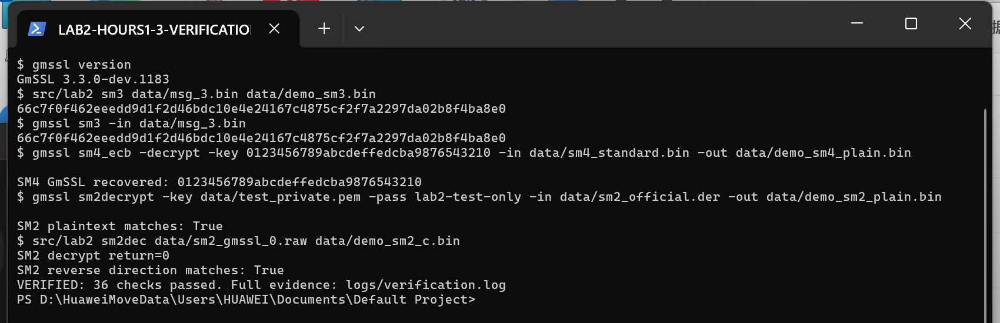

# 实验二：密码算法实现——1—3学时实践记录

课程：密码系统设计　班级：2413　姓名：蔡贸俊　学号：20241328

指导教师：赵越（老师模板所列）　实际验证日期：2026年10月22日

## 1. 实验内容

### 1.1 实验目的与要求

理解 SM2、SM3、SM4 的原理与 C 语言实现，在 openEuler 中编译调试商用密码检测中心的参考源码，以标准测试向量和 GmSSL 命令验证结果；查找密码行业标准，分析标准步骤与代码函数的对应关系，记录实际调试问题和运行效率。

本实践记录对应指导书“实验二：1—3学时实践要求”。本阶段要求及完成情况如下：

| 要求 | 分值/性质 | 本次完成情况 |
|---|---|---|
| 调试运行检测中心的SM2、SM3、SM4参考源码，用GmSSL命令验证并记录过程 | 14分；其中包含按功能提交Git的过程要求 | 三算法与软件交叉验证已通过；本次按算法归档提交，见2.8节 |
| 查找SM2、SM3、SM4标准并分析代码对应关系 | 6分 | 已保存真实标准查询结果、标准PDF并逐项分析 |
| 使用Rust完成三算法实现 | 选做10分 | 本次未选做 |
| 提供课程仓库链接、本次git log，提交Markdown及转换PDF | 提交要求 | Markdown/PDF、代码、日志、课程仓库链接和本次真实Git记录已整理 |

三算法运行及标准分析已完成。本次将既有实验成果按SM3、SM4、SM2与验证工具分组，创建当前时间的真实归档提交，再提交实践文档。归档时间不等于最初开发时间；第三方MIRACL历史只用于版本溯源。提交记录见2.8节。

### 1.2 实验环境

| 项目 | 实际环境 |
|---|---|
| 操作系统 | openEuler 24.03 LTS，运行于 Windows WSL2 |
| 内核与架构 | Linux 6.18.33.2-microsoft-standard-WSL2，x86_64 |
| 编译器 | GCC 12.3.1（openEuler 12.3.1-38.oe2403） |
| 编程语言 | C11；Python 3 辅助生成数据、转换编码、比对与记录日志 |
| 独立验证工具 | GmSSL 3.3.0-dev.1183 |
| 大数/椭圆曲线依赖 | MIRACL，提交 b9b8fd471de253cfd6313446cb490741edb069a7，LP64 配置 |
| 编译产物 | ELF 64-bit LSB executable，x86-64 |

实际运行平台是国产 openEuler 操作系统上的 x86_64 环境；产物架构已经通过file命令核对。算法主体来自检测中心：SM3 的消息扩展/压缩、SM4 的密钥扩展/轮变换、SM2 的点乘/KDF/加解密流程均保留在 C 源码中。MIRACL 提供底层大数与椭圆曲线运算。GmSSL 作为独立验证工具，仅辅助程序 `test_key.c` 调用其库将公开测试私钥序列化，不代替被测算法实现。

### 1.3 文件分工

| 文件 | 作用 |
|---|---|
| src/SM3.c、SM3.h | 检测中心 SM3 实现及原自检 |
| src/SM4.c、SM4.h | 检测中心 SM4 实现及原自检 |
| src/SM2_ENC.c、SM2_ENC.h、kdf.h | 检测中心 SM2 公钥加解密、曲线参数及 KDF |
| src/main.c | 实验命令入口、输入检查、自检与计时 |
| src/test_key.c | 为 GmSSL 命令生成 d=1 的测试密钥文件 |
| tools/verify_linux.py | 编译、交叉验证、DER 转换及实际日志保存 |
| materials/ | 原指导书、检测中心 RAR/PDF、标准及下载清单 |
| logs/ | 编译记录、完整命令/输出/退出码及结果汇总 |

## 2. 实验步骤

### 2.1 获取参考源码并恢复可编译文件

**操作内容。** 按指导书访问检测中心算法源代码下载页，下载 SM2、SM3、SM4 三个官方 RAR。原压缩包实际上包含代码 PDF，而不是可以直接编译的 `.c` 文件。保留原 RAR、PDF 和提取文本，由前次实验恢复脚本生成可编译版本；本目录已包含最终C源码，本次从源码重新构建验证。原作者为 Mao Yingying、Huo Lili，SM2_ENC 版本 V1.1，SM3 版本 V1.1，SM4 版本 V1.0。

恢复时处理 PDF 把 `0x95` 拆成两行等排版问题；整理注释与空白；将 MIRACL 旧接口名 `compare` 对应到当前版本的 `mr_compare`。SM2 的 KDF 附带一份以 `unsigned long` 保存字状态的 SM3，在 LP64 环境会成为 64 位，故复用同一官方包体系中的独立 SM3 32 位实现，保留原 KDF 主体。SM4 在移位前显式转为 `unsigned int`，避免字节提升为有符号 `int` 后左移进入符号位。

**操作结果。** 三种算法恢复并链接成功；修改说明见 `src/SOURCES.md`，原始内容仍可逐页对照。原站点存在旧 TLS 与证书链兼容问题，本次下载使用临时客户端兼容回退，记录于 `materials/download_manifest.json`；其中 SHA-256 用于本地文件完整性核对，不等同于站点签名认证。

### 2.2 配置 MIRACL 并编译运行原自检

**操作内容。** 从 MIRACL 官方仓库取得大数库，依照其 `amd64.txt` 选择 64 位 LP64 配置：`MIRACL=64`、`mr_utype=long`、`MR_LBITS=64`，使用 `mrmuldv.g64`。`src/miracl` 保留构建所需源文件，便于离线重编译。

在实验目录执行：

```bash
make -C src -j4
file src/lab2
./src/lab2 selftest
```

`make -C src` 指定源码目录，`-j4` 表示最多四项并行编译；主程序使用 `-O2 -g -std=c11 -Wall -Wextra -fno-strict-aliasing`，最后一个选项用于兼容参考代码中的字节缓冲区到 32 位字的访问方式。

**操作结果。** GCC 编译及链接退出码为 0，产物为 x86-64 ELF。参考实现仍有未使用变量与 `char*`/`unsigned char*` 接口警告，详见 `logs/build.log`；本次不把成功编译描述为零警告。

```text
SM3 official selftest: PASS
SM4 official selftest: PASS
SM2 official selftest: PASS (rc=0)
SM2 tampered C3: PASS (rc=6, expected=6)
```

SM2 原自检使用其自带固定私钥、随机数和 `encryption standard` 明文，比较派生公钥、115 字节密文及解密结果。SM3 原自检包括 `abc` 与 64 字节的 `abcd` 重复串；SM4 原自检比较标准加密与解密结果。

### 2.3 验证 SM3 杂凑算法

**操作内容。** 由 `SM3_256` 调用 `SM3_init`、`SM3_process`、`SM3_done` 计算摘要。测试入口读取字节文件并输出 32 字节二进制摘要，使用相同输入调用 GmSSL：

```bash
./src/lab2 sm3 data/msg_3.bin data/sm3_c.bin
gmssl sm3 -in data/msg_3.bin -bin -out data/sm3_gmssl.bin
cmp data/sm3_c.bin data/sm3_gmssl.bin
```

`msg_3.bin` 的内容是无换行的 ASCII `abc`，避免文本末尾换行引起摘要差异。完整自动验证使用 Python 对两个摘要文件逐字节比较。

**操作结果。** `abc` 的两端摘要均为：

```text
66c7f0f462eeedd9d1f2d46bdc10e4e24167c4875cf2f7a2297da02b8f4ba8e0
```

另测试长度 0、1、55、56、63、64、65、127、128、1024 字节，加上 `abc` 共 11 组，全部一致。55/56 字节测试覆盖长度字段加入时是否额外产生一个分组的边界，63/64/65 字节测试覆盖分组切换。除 `abc` 外，各文件第 i 字节按 `(37*i+11) mod 256` 生成，输入保留在 `data/`。

### 2.4 验证 SM4 分组密码算法

**操作内容。** `SM4_KeySchedule` 产生 32 个轮密钥，`SM4_Encrypt` 执行 32 轮非线性与线性变换，`SM4_Decrypt` 逆序使用轮密钥。固定标准密钥和一个 16 字节明文，不引入填充，和 GmSSL 的 ECB 单分组结果比较。

```bash
./src/lab2 sm4 enc data/sm4_plain.bin data/sm4_c.bin
gmssl sm4_ecb -encrypt -key 0123456789abcdeffedcba9876543210 \
  -in data/sm4_plain.bin -out data/sm4_gmssl.bin
./src/lab2 sm4 dec data/sm4_gmssl.bin data/sm4_recovered.bin
```

**操作结果。** 标准向量如下；标准分组结果另存为 `data/sm4_standard.bin`，自动验证中的工作文件最后保存的是第 8 组数据。

| 项目 | 十六进制值 |
|---|---|
| 密钥 | 0123456789abcdeffedcba9876543210 |
| 明文 | 0123456789abcdeffedcba9876543210 |
| 密文 | 681edf34d206965e86b3e94f536e4246 |

共验证 8 组明文，每组均完成 C 加密与 GmSSL 加密比对，并由 C 解密 GmSSL 密文恢复原字节。其余 7 组第 j 字节为 `(19*j+31*i) mod 256`，i=1…7。16 次对照全部一致。输入 3 字节文件时程序返回 2，输出提示要求恰好一个 16 字节分组，未生成密文文件。

### 2.5 验证 SM2 公钥加解密及编码互操作

**操作内容。** `SM2_Init` 初始化曲线；`SM2_KeyGeneration` 计算公钥 `[d]G`；加密计算 `[k]G`、`[k]P`、SM3-KDF、异或和校验摘要；解密计算 `[d]C1` 后恢复明文并比较 C3。

新增互操作用例的明文是 UTF-8 字节串 `20241328 蔡贸俊`，长度为 18 字节。测试固定 d=1、k=2，以便结果可复现；它们是公开的测试夹具，不用于实际保密。GmSSL 反向加密由其自身生成随机数，共运行 3 次。

需要特别区分三种层次：GM/T 0003.4-2012 第6.1节原文 A8 给出 `C1||C2||C3`；本次检测中心代码明确实现并输出 `C1x||C1y||C3||C2`；GmSSL 命令使用 ASN.1 DER 的 `SEQUENCE(INTEGER x, INTEGER y, OCTET STRING C3, OCTET STRING C2)`。不能把格式差异当作密码运算错误，也不能不经转换直接拼接。`verify_linux.py` 的 `raw_to_der` / `der_to_raw` 仅改变表示形式，保留坐标、摘要和密文内容。

```bash
gcc -O2 src/test_key.c -lgmssl -o src/test_key
./src/test_key
gmssl sm2decrypt -key data/test_private.pem -pass lab2-test-only \
  -in data/sm2_official.der -out data/sm2_gmssl_plain.bin
gmssl sm2encrypt -pubkey data/test_public.pem -in data/message.bin \
  -out data/sm2_gmssl_0.der
./src/lab2 sm2dec data/sm2_gmssl_0.raw data/sm2_c_plain.bin
```

`test_key.c` 只负责将已知 d=1 的测试密钥写成 GmSSL 命令可读取的加密 PKCS#8 私钥及公钥。DER 与原始字节转换在自动化脚本中完成，以上手动命令需要使用已生成的相应数据文件。

**操作结果。** C 实现加密→GmSSL 解密恢复相同的 18 字节原文；GmSSL 随机加密→C 解密连续 3 次恢复原文。修改 C3 的一个比特后，C 解密返回 6（`ERR_C3_MATCH`），入口未输出明文文件；过短密文由入口拒绝并返回 2。这些观察证明已测正常及失败路径，不代表对全部无效曲线点或所有恶意输入进行了安全审计。

### 2.6 运行截图及验证汇总

下图为本机实际 PowerShell / WSL 终端窗口截图，展示 SM3 双端摘要、SM4 解密恢复、SM2 双向互操作与自动验证结论。截图由 `tools/demo_linux.py` 实际运行后采集；完整命令、原始输出和退出码见 `logs/verification.log`。



| 验证类别 | 已通过的检查条目数 |
|---|---:|
| 三算法原自检及 C3 篡改组合检查 | 1 |
| SM3 与 GmSSL 比对 | 11 |
| SM4 加密比对、反向解密、标准密文、长度拒绝 | 18 |
| SM2 双向加解密、C3 失败不输出、截断拒绝 | 6 |
| 合计 | 36 |

这里的“条目数”是脚本中显式断言的数量；组合自检条目内部包含多项向量比较，不应解读成只有一种测试输入。

### 2.7 查找标准并分析代码对应关系

**操作内容。** 在密标委标准列表按 SM2、SM3、SM4 查询，保存真实接口返回的 `standards_SM2.json` 等记录，下载并查看相关标准扫描 PDF。所列 GM/T 文本均来自该站点，标准正文的页码与 PDF 页面序号不同，以下采用章节号定位。

| 算法/标准 | 标准中的步骤 | 实现位置和分析 |
|---|---|---|
| SM2：GM/T 0003.1、0003.4、0003.5-2012 | 基础曲线运算、参数、公钥检验 | SM2_ENC.h 保存 p、a、b、n、G、h；SM2_Init 初始化并检查 [n]G；Test_Point 检查曲线方程；Test_PubKey 检查无穷点、坐标范围及阶 |
| SM2：0003.4 第5.4.3节 | KDF：计数器 ct 从1起，对 Z||ct 杂凑并拼接/截断 | kdf.h 的 SM3_KDF；这里长度参数以字节给出，内部乘8转换为位数 |
| SM2：0003.4 第6.1节 A2—A7 | C1=[k]G，S=[h]PB，[k]PB，KDF，异或，C3 | SM2_Encrypt 顺序执行点乘、Test_Null、SM3_process/SM3_done；k由调用者给出，固定k仅供测试 |
| SM2：0003.4 第7.1节 B1—B6 | 解析C1、共享点、KDF、恢复消息、摘要校验 | SM2_Decrypt；main.c先检查输入长度，C3不匹配时不保存明文。原标准A8的拼接顺序与参考代码不同，按2.5节显式处理 |
| SM3：GM/T 0004-2012 第4、5节 | 初始值与常量、消息填充、消息扩展、压缩、输出 | SM3_init 设置8个32位字；SM3_done 填充；BiToW 得到 W[68]；WToW1 得到 W′[64]；CF 进行64轮压缩并异或链接值 |
| SM3：第5.2节与附录A | 填充长度字段、标准向量 | 55/56等边界与GmSSL一致；参考代码仅保存低32位比特长度，不能宣称支持标准允许的全部小于2^64位输入 |
| SM4：GM/T 0002-2012 第6、7节 | S盒、线性变换L、加解密、密钥扩展L′ | SM4_Sbox 为256项；加解密用2/10/18/24位循环移位，密钥扩展用13/23位移位；SM4_CK、SM4_FK与标准常量对应 |
| SM4：第7.2节及附录A.1 | 解密轮密钥逆序、示例1 | SM4_Decrypt使用rk[31-i]；SM4_SelfCheck得到681edf34…536e4246，和GmSSL一致 |

GM/T 0003.2-2012 对应数字签名算法，本次也保留该标准及官方签名源码 PDF，但本次运行范围是 SM2 公钥加解密，未把未编译运行的签名/密钥交换写作已验证功能。

### 2.8 课程仓库与本次Git提交记录

课程仓库：https://github.com/1515720698/cryptosystem

分支：`master`；本次目录：`20241328-蔡贸俊-实验二-1-3学时/`。

本次在原有课程历史之后按算法分组归档，三个代码提交如下。它们是已有实验完成后的实际整理提交，没有回填或伪造早期开发日期。

| 提交号 | 实际归档内容 |
|---|---|
| c5fa530a5691665c1949f5f2c7ec095e03e6aa4c | 检测中心SM3实现、原始源码材料与对应标准 |
| 3357886efe16d463d8c6009a0e7733be62e7b504 | 检测中心SM4实现、原始源码材料与对应标准 |
| 889d7d667819d6746e16b50acc55c37f15b5580e | SM2加解密、MIRACL构建依赖、GmSSL交叉验证工具和测试数据 |

实际运行的Git命令及作者、日期、完整提交号见 [本次git log原始输出](logs/git_log.txt)。该日志在最终文档提交之前生成；包含最终文档提交的完整历史，可在课程仓库的 [提交历史](https://github.com/1515720698/cryptosystem/commits/master/) 中查看。

在克隆后的课程仓库根目录复查：

```bash
git log --date=iso-strict --oneline -- "20241328-蔡贸俊-实验二-1-3学时"
```

## 3. 实验体会

### 3.1 调试中出现的问题及解决过程

1. **官方“源代码包”内是PDF。** 直接编译无入口；提取文本后出现十六进制常量跨行。将原PDF与提取文本同时保留，用脚本恢复完整token并建立main入口，最终三个官方自检均通过。
2. **SM2依赖库未随包提供。** 注释声明基于MIRACL。补齐官方MIRACL源码，依照amd64配置编译；发现旧代码的compare名称与当前头文件不一致，改为mr_compare后链接成功。
3. **LP64上的字长与原实现假设不一致。** KDF附带SM3使用unsigned long，而算法状态要求32位。在Linux x86_64上采用同源独立SM3的unsigned int版本，避免64位状态破坏计算；再以官方SM2向量与GmSSL互操作确认。
4. **SM2输出格式不同。** 原始坐标拼接无法直接传给要求DER的命令。明确原代码的C1/C3/C2布局，在Python中处理INTEGER补零、SEQUENCE长度及OCTET STRING；两方向加解密随后通过。
5. **仅自解密不足以证明正确性。** 编码或轮函数错误可能在自洽实现中同时存在。追加官方向量、GmSSL跨实现比较，以及C3篡改和分组长度拒绝测试，使结论对应独立依据。

### 3.2 心得体会（AI代拟，待本人核对）

本次结果表明，验证算法实现需要同时核对算法公式、C语言的数据表示和工具的输入输出格式。SM3的填充边界、SM4的无符号移位以及SM2的密文编码都直接影响结果。后续本人复核时，应能够解释每个输入文件的字节内容、指出关键函数与标准的对应位置，并在终端重新演示双端验证。个人实际操作感受和学习收获请在提交前据本人情况补充。

### 3.3 实验改进建议

后续实践应在开发过程中及时按功能提交，区分开发提交与成果归档；扩展SM3为64位消息长度并消除主机大小端假设；为SM2大数与点对象建立明确释放路径，完善异常点和随机数处理；若进行效率比较，应统一随机参数、密钥扩展是否计入及样本规模，重复测量后给出分布而非单次数值。

## 4. 参考资料与工具说明

1. 《实验要求(stu) (1).md》，“实验二：1—3学时实践要求”，原件保留于materials。
2. 商用密码检测中心算法源代码下载页：https://www.scctc.org.cn/xzzx/sfydm/ydmxz/ 。官方压缩包链接与哈希见download_manifest.json。
3. 密码行业标准化技术委员会标准列表：http://www.gmbz.org.cn/main/bzlb.html 。实际查询结果和GM/T 0002、0003各部分、0004文本保留于materials。
4. MIRACL官方源码及amd64构建说明：https://github.com/miracl/MIRACL ，实际版本见环境表，构建所需源码与说明保留于src/miracl。
5. 本机GmSSL命令帮助及已安装头文件，版本3.3.0-dev.1183；命令执行情况见原始日志。

本次由OpenCode协助提取代码、编写入口/验证脚本和整理报告，使用模型为gpt-6.1-sol。运行结果来自本机实际执行，待补事项按实际状态列示；未编造个人操作经历或课程提交记录。
