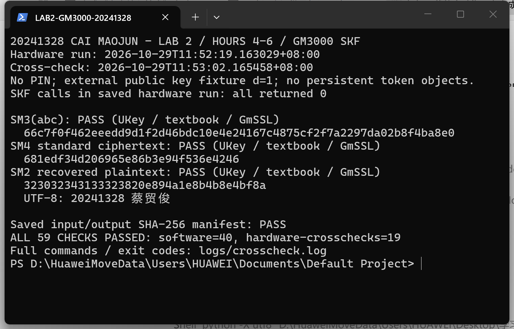

# 实验二：密码算法实现——4—6学时实践记录

课程：密码系统设计　班级：2413　姓名：蔡贸俊　学号：20241328

指导教师：赵越（老师模板所列）　实际验证日期：2026年10月29日

## 1. 实验内容

### 1.1 实验目标及完成标准

在 openEuler 中运行老师提供的教材 SM2、SM3、SM4 源码，使用 GmSSL 命令和 GM3000 UKey 交叉验证；查找相关密码行业标准，分析教材函数与标准步骤的对应关系，提交实践记录、PDF、源码及真实 Git 记录。

| 指导书任务 | 分值 | 本次完成情况 | 对应证据 |
|---|---:|---|---|
| 教材三算法编译、调试与 GmSSL 对照 | 15 | 三算法均运行；SM3/SM4比对、SM2双向互操作通过 | 2.1—2.5节，crosscheck.log |
| SM2/SM3/SM4标准查找及代码对应 | 10 | 保留标准PDF、查询记录、原始教材及逐文件适配差异 | 2.6节，materials/ |
| 使用 GmSSL、UKey 交叉验证 | 5 | SM3、SM4三方一致；UKey SM2密文由两套软件正确解密 | 2.3—2.5节，ukey_results.json |
| 课程仓库链接、本次 git log | 提交要求 | 已生成真实本地归档提交及Git日志；本阶段尚未推送课程远端 | 2.8节 |
| Markdown、PDF及模板报告 | 提交要求 | 实践记录及中文PDF；另存老师模板版DOC/DOCX/PDF | 提交清单 |

本记录仅将实际通过的用例列为完成；没有使用设备内私钥、证书、PIN，也未把外部公钥加密写作设备私钥解密。第一阶段检测中心源码的36项验证已于2026年10月22日完成并发布，其记录与本次教材实现分开保留。

### 1.2 实际运行环境

| 项目 | 实测环境 |
|---|---|
| 教材算法平台 | openEuler 24.03 LTS / WSL2 / x86_64 |
| Linux内核 | 6.18.33.2-microsoft-standard-WSL2 |
| 编译器 | GCC/G++ 12.3.1，Linux产物实际为64位ELF |
| 独立软件对照 | GmSSL 3.3.0-dev.1183；Windows hashlib SM3辅助比对 |
| SM2大数/曲线依赖 | MIRACL源码，LP64配置；来源提交见src/SOURCES.md |
| 硬件及接口平台 | Longmai GM3000 UKey，Windows 64位Python调用SKF库 |
| SKF库 | SDK中skf/windows/x64/mtoken_gm3000.dll，已验证AMD64架构 |
| ABI约束 | stdcall；ULONG为32位；结构体1字节对齐；句柄为指针宽度 |

本次由Windows直接访问USB设备，openEuler读取保存的硬件输出进行跨实现验证，没有声称UKey已通过USB透传在WSL内直接运行。实际平台为x86_64，未进行Arm实机验证。

## 2. 实验步骤

### 2.1 确认教材代码来源并生成Linux构建副本

**操作内容。** 使用用户提供的 `Win加密解密-code(1).rar`，保留原包与完整解压目录；原包SHA-256为 `B92049BEA16ECC99E636823F70C6A7BEF590B8848AB0BEEC13D552686F6C618A`。教材SM4位于第3章3.6，SM3位于第4章4.2，SM2位于第14章14.2。将必要原文件另存至 `materials/textbook_selected/`，确保提交材料不依赖整套Visual Studio缓存。

运行 `tools/prepare_textbook_sources.py` 生成 `src/textbook/`：移除Visual Studio空预编译头引用；正确读取原文件GB18030或UTF-8编码；将SM3与KDF依赖Windows的32位unsigned long改为uint32_t；为循环移位计数按32取模；SM4字节左移前转为unsigned int，避免整数提升后的有符号左移问题。

**操作结果。** 原教材不变，构建副本与每个原文件的SHA-256、逐行修改记录保存在 [源码来源核对](logs/textbook_source_provenance.json) 和 [适配差异](logs/textbook_portability.patch)。修改并非重新实现算法轮函数，教材SM2/KDF、SM3、SM4的主体仍由对应教材文件编译。

### 2.2 编译教材三算法并记录接口差异

**操作内容。** Linux验证入口自动调用G++编译教材SM3、SM4，调用GCC编译教材SM2/KDF与MIRACL源代码。三个驱动负责读写二进制文件、输入长度检查及返回码处理。教材Windows版 `mymiracl.lib` 不参与Linux链接；教材头文件中的全局变量定义采用 `-fcommon` 兼容，KDF原字缓冲区访问采用 `-fno-strict-aliasing`。

在本文件夹运行：

```powershell
powershell -ExecutionPolicy Bypass -File .\运行实验.ps1
```

上述入口先在Windows运行 `verify_ukey.py`，再调用openEuler中的 `verify_crosscheck.py`。已有本次硬件输出、仅重跑软件比对时使用 `-ReuseHardware`；该参数不会重新调用UKey。依赖为Python、GCC/G++、GmSSL开发库及libubsan；缺少后者时可在openEuler安装 `dnf install -y libubsan`。

**操作结果。** 三个产物均通过 `file` 检查为x86-64 ELF。完整命令、输出、退出码见 [最终验证日志](logs/crosscheck.log)，编译警告见 [编译日志](logs/build_current.log)。教材仍有未使用变量及MIRACL字节指针签名等警告，不能把构建成功表述为零警告。SM2教材标准自检比较派生公钥、115字节密文和19字节明文，实际返回0。

### 2.3 SM3：教材、GmSSL、UKey三方摘要验证

**操作内容。** 软件测试输入长度为0、1、3、55、56、63、64、65、127、128、1024字节。3字节输入为无换行ASCII `abc`，其他输入第i字节为 `(37*i+11) mod 256`。教材驱动调用 `sm3()`，GmSSL使用二进制输出，避免编码和尾换行干扰。

```bash
build/textbook_sm3 data/soft_msg_3.bin data/soft_sm3_3.bin
gmssl sm3 -in data/soft_msg_3.bin -bin -out data/gmssl_sm3_3.bin
```

UKey使用头文件中确定的 `SGD_SM3=0x00000001`，按 `SKF_DigestInit → SKF_Digest → SKF_CloseHandle` 调用；选取1、3、55、56、63、64、65、1024字节的8组输入，实际摘要保存在 `data/ukey_sm3_*.bin`。55/56和63/64/65字节覆盖填充及分组切换边界。

**操作结果。** 11组教材/GmSSL结果一致，8组UKey摘要同时与教材和GmSSL一致。`abc`三方均得到：

```text
66c7f0f462eeedd9d1f2d46bdc10e4e24167c4875cf2f7a2297da02b8f4ba8e0
```

早期探测中，UKey一次性摘要接口对零字节输入返回 `0x00008001`，因此硬件通过列表不包含空输入；软件空串测试单独通过，未将设备拒绝结果改写为成功。

### 2.4 SM4：标准向量、三方密文和反向恢复

**操作内容。** 使用公开标准测试密钥 `0123456789abcdeffedcba9876543210`，对恰好16字节的单分组执行ECB且不填充。软件共8组，UKey使用前4组。第0组明文等于标准密钥，其余第j字节按 `(19*j+31*i) mod 256` 生成。

SKF流程为 `SKF_SetSymmKey(SGD_SM4_ECB=0x401) → SKF_EncryptInit → SKF_Encrypt → SKF_DecryptInit → SKF_Decrypt → SKF_CloseHandle`。`BLOCKCIPHERPARAM`的PaddingType为0，不创建持久密钥对象。软件对照命令：

```bash
build/textbook_sm4 enc data/soft_sm4_plain_0.bin data/soft_sm4_cipher_0.bin
gmssl sm4_ecb -encrypt -key 0123456789abcdeffedcba9876543210 \
  -in data/soft_sm4_plain_0.bin -out data/gmssl_sm4_cipher_0.bin
build/textbook_sm4 dec data/gmssl_sm4_cipher_0.bin data/soft_sm4_recovered_0.bin
```

**操作结果。** 标准密文为 `681edf34d206965e86b3e94f536e4246`；4组UKey密文与教材、GmSSL逐字节一致，UKey自身解密恢复相同明文。8组GmSSL密文均能由教材解密恢复；3字节非法输入返回2且不产生输出文件。ECB仅用于隔离单分组算法验证，不作为实际文件加密方案建议。

### 2.5 SM2：软件双向互操作及UKey加密验证

**操作内容。** 使用公开测试夹具d=1，其公钥为标准曲线基点G。消息为UTF-8 `20241328 蔡贸俊`，恰好18字节，十六进制为 `323032343133323820e894a1e8b4b8e4bf8a`。公开测试私钥只用于本机GmSSL命令读取，不是UKey内私钥；由 `test_key.c` 运行时生成，不放入提交包。

教材入口从 `/dev/urandom` 获取满足1≤k<n的随机数，完成“教材加密→GmSSL解密”；反向完成“GmSSL加密→教材解密”，各运行3次。`test_key.c`调用GmSSL库仅序列化密钥夹具，不替代教材算法。

UKey调用 `SKF_ExtECCEncrypt`，输入d=1对应的外部公钥和同一消息，独立运行3次。SKF结构与教材、GmSSL的表示不同：

| 表示 | 数据布局 | 本次处理 |
|---|---|---|
| SKF ECCCIPHERBLOB | X[64]、Y[64]、HASH[32]、CipherLen(uint32)、Cipher[] | 256位坐标右对齐，取各槽后32字节；Cipher起始偏移164 |
| 教材原始字节 | C1x[32]、C1y[32]、C3[32]、C2 | 18字节明文对应114字节密文，无额外04标记 |
| GmSSL DER | SEQUENCE(INTEGER x, INTEGER y, OCTET STRING C3, OCTET STRING C2) | 用TLV转换，仅变更表示，不修改密码数据 |

原始SKF结构、教材格式与DER分别保存在 `ukey_sm2_i.skfblob`、`.raw`、`.der`。其后执行：

```bash
build/textbook_sm2 dec data/ukey_sm2_0.raw data/textbook_from_ukey_0.bin
gmssl sm2decrypt -key data/test_private.pem -pass lab2-test-only \
  -in data/ukey_sm2_0.der -out data/gmssl_from_ukey_0.bin
```

**操作结果。** 3次UKey加密均返回0，CipherLen为18；三份密文彼此不同，分别经教材和GmSSL解密都恢复同一18字节原文。验证方式是明文恢复，不要求随机加密密文相等。翻转C3一位后教材返回6（ERR_C3_MATCH），驱动没有保存未经校验的明文；3字节截断密文返回2。这里只验证了SKF外部公钥加密，不涉及内部私钥解密、证书或签名验签。

### 2.6 查找标准并逐项分析教材实现

**操作内容。** 沿用第一阶段从密标委实际查询并保存的SM2、SM3、SM4标准，现按教材函数重新分析。`materials/standards_SM*.json`为查询记录，标准扫描PDF一并保留。使用标准章节号定位，避免混淆PDF页序与正文页码。

| 算法及标准 | 标准过程 | 本次教材文件、函数与对应关系 |
|---|---|---|
| SM3，GM/T 0004-2012第4、5节 | 初始值、填充、长度编码 | sm3.cpp：sm3_starts设置8个初值，sm3_finish按56字节阈值填充并写入长度 |
| SM3，第5节 | W[68]与W′[64]消息扩展、64轮压缩 | sm3_process构造W/W1，使用P0/P1、FF/GG、循环移位及模2^32运算，最后异或更新链接值 |
| SM4，GM/T 0002-2012第6、7节 | 密钥扩展、非线性变换、线性变换 | sm4.cpp：SM4_Sbox、FK/CK；SM4_KeySchedule使用13/23位循环移位产生32个轮密钥 |
| SM4，第7节及附录A | 加密、解密及标准向量 | SM4_Encrypt使用2/10/18/24位移位，32轮后反序输出；SM4_Decrypt使用rk[31-i] |
| SM2，GM/T 0003.1、0003.5-2012 | 曲线参数、基点与公钥检查 | SM2_ENC.c的p/a/b/n/G/h数组、SM2_Init、Test_Point、Test_PubKey对应曲线初始化和公钥合法性检查 |
| SM2，GM/T 0003.4-2012第5.4.3节 | KDF计数器从1开始，对Z||ct杂凑 | kdf.c的SM3_KDF保留计数器递增、拼接、末块截断；参数长度以字节传入，内部乘8 |
| SM2，第6.1节A2—A7 | C1=[k]G、[h]PB、[k]PB、KDF、异或、C3 | SM2_Encrypt按上述顺序调用MIRACL点乘和教材KDF/SM3 |
| SM2，第7.1节 | 共享点、恢复明文、校验C3 | SM2_Decrypt计算[d]C1并校验摘要；文件驱动仅在返回0时保存明文 |

**分析结果。** GM/T 0003.4-2012第6.1节A8原文给出C1||C2||C3，而教材和本SDK适配采用C1坐标、C3、C2布局；必须显式区分编码顺序，不能直接把SKF内存或DER传入教材函数。教材SM3与KDF各有一份SM3实现，本次分别维持原主体并修正32位字宽。KDF内SM3仅编码低32位消息比特长度，本实验输入很短，不能据此声称完整支持标准全部长度范围。

### 2.7 实际截图与验证汇总

下图是实际终端窗口截图。窗口运行 `tools/demo_results.py`，重新核对已经保存的硬件输出、三方字节一致性与输入输出SHA-256；它不是重画的日志图，也不声称截图时重新执行了设备随机加密。



最终 `verify_crosscheck.py` 显式断言统计如下；硬件调用脚本内的长度、自恢复等检查另存JSON，不重复相加：

| 检查类别 | 条目数 | 实际结果 |
|---|---:|---|
| 教材SM2标准自检 | 1 | 通过 |
| SM3教材/GmSSL软件比较 | 11 | 通过 |
| SM4软件加密比较、恢复、标准向量、非法长度 | 18 | 通过 |
| SM2软件双向互操作、C3失败、截断拒绝 | 8 | 通过 |
| SM3/SM4代表输入UBSan检查 | 2 | 通过 |
| SM3三方硬件交叉比较 | 8 | 通过 |
| SM4三方硬件交叉比较 | 4 | 通过 |
| SM2 UKey密文交两套软件解密及密文差异检查 | 7 | 通过 |
| 合计 | 59 | 软件40、硬件交叉19 |

结果及完整命令分别见 [机器可读结论](logs/crosscheck_results.json)、[SKF返回码](logs/ukey_results.json)、[软件命令日志](logs/crosscheck.log)。这些检查证明已测输入范围下的正确性，不等于安全审计或性能认证；没有以一次随机性检查推断随机数发生器安全性。

### 2.8 课程仓库与真实Git归档记录

课程仓库：https://github.com/1515720698/cryptosystem 。第一阶段目录已在该仓库发布；本次4—6学时材料建立了独立本地Git归档，尚未推送到课程远端，不把远端旧记录当成本阶段提交。

| 本地提交 | 归档内容 |
|---|---|
| 79c5598173404668abd28b8e1c3fe52849bff199 | 教材SM3、原始子集及32位字宽适配 |
| 591307c67d6a43b2fbef37307559477ac7882e6c | 教材SM4、原始子集及分组输入检查 |
| cce439c54b08b2b286b94e84fcf9d2049b53eb3d | 教材SM2、MIRACL、SKF运行库、实际三方验证程序和数据 |

这三条是当前时间的成果归档提交，不追溯冒充之前的逐函数开发历史。文档与证据另作归档提交；最终完整日志见 `logs/git_log_完整.txt`，Git历史随 `实验二_4-6学时_本地Git历史.bundle` 交付，可离线克隆查看。报告中的 [git log原始输出](logs/git_log.txt) 生成于文档提交前，记录上述三条代码归档。

## 3. 实验体会

### 3.1 调试问题及解决过程

1. **Windows工程不能直接用于Linux。** 预编译头为空但Linux找不到pch.h，且mymiracl.lib不是ELF库。移除构建副本的预编译头引用，用已保存的MIRACL源码构建，三个产物均为64位ELF。
2. **unsigned long字宽变化。** Windows中32位的SM3状态在Linux LP64上会变64位。改为uint32_t保留模2^32语义，并修复移位计数32/超32以及字节提升的未定义行为；SM3/SM4代表输入的UBSan检查通过。
3. **错误编码读取导致中文输出乱码。** 原教材混用GB18030和UTF-8，先用UTF-8严格解码，失败后按GB18030读取；源码注释和SM2“原文/密文/解密结果”输出恢复正常。
4. **厂商DLL架构与机制号。** 桌面工具内库为32位，与64位Python不匹配；盲猜PKCS#11机制曾导致独立调用进程异常。取得课程仓库SDK后改用实际x64 SKF库，严格按头文件的uint32、pack(1)和算法常量声明调用，最终三算法返回0。
5. **零长度摘要的设备行为与软件不同。** SKF一次性摘要对空输入返回0x8001，没有继续宣称硬件支持空串；选用8组非空输入进行设备交叉验证，软件空串单独验证。
6. **检测工具依赖不足。** 初次UBSan链接提示找不到-lubsan；在openEuler安装对应libubsan后，从完整入口重新运行，最终59项断言通过。

### 3.2 心得体会（AI代拟，待本人核对）

本次实验表明，教材公式正确并不意味着跨平台编译即可得到正确结果。字宽、移位、结构体对齐、密文格式与消息编码都需要逐项确认。对称算法可比较同一密钥和输入的密文；SM2随机加密则应通过跨实现解密恢复原文来判断。本人提交前应能现场指出SKF结构中各字段的用途，解释为什么公开d=1夹具不是设备私钥，并亲自复现主要命令后补充个人学习体会。

### 3.3 改进建议

后续可以在不影响现有容器的条件下另行学习设备私钥签名与证书操作；这不属于本次已完成的功能。教材SM2需要改进异常点校验和内存释放，KDF长度计数也有适用范围限制。若开展效率对照，应统一平台、密钥扩展是否计入、随机数生成及USB往返开销，多次采样报告分布；本阶段未把接口调用耗时当作芯片性能结论。

## 4. 参考资料与工具说明

1. 老师《实验要求(stu) (1).md》实验二4—6学时要求和原实验报告模板，保存在materials。
2. 用户提供的教材代码RAR，第3章3.6、第4章4.2、第14章14.2原工程；所用文件哈希与差异见logs。
3. 课程资料仓库：https://gitee.com/rocedu/bestidiocs4stu ，实际检出提交048ec69e7998c9d13eb4624541acbe6b1e089589；ch06/longmaiskf0016-stu.zip。
4. SDK中skf/skfapi.h、GM3000开发者指南、加密及签名示例；必要原件保存在materials/GM3000_runtime。
5. 密标委标准列表：http://www.gmbz.org.cn/main/bzlb.html ，本次使用第一阶段真实保存的查询结果和GM/T 0002、0003相关部分、0004 PDF。
6. MIRACL官方仓库 https://github.com/miracl/MIRACL ，源文件及原版权说明保留于src/miracl；GmSSL命令帮助与本机头文件。

本次由OpenCode（gpt-6.1-sol）协助编写驱动、适配及验证脚本，实际结果来自本机Windows/openEuler/GM3000执行。个人心得标为代拟，不编造个人操作经历。
