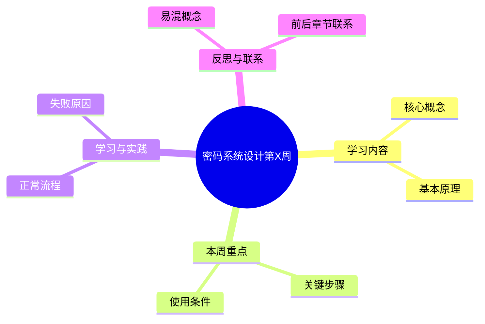
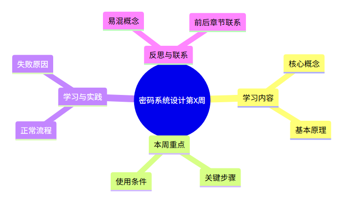

# 密码系统设计 第 X 周预习报告

**学号**：20241328　**姓名**：蔡贸俊  
**学习内容**：《Windows C/C++加密解密实战》第 X 章“章节名称”  
**课程仓库**：[1515720698/cryptosystem](https://github.com/1515720698/cryptosystem)

## 一、AI 对学习内容的总结（1分）

### 1. 本周学习主线

本周主要学习【核心主题】，重点理解【知识点一】与【知识点二】的联系，并掌握【主要操作或接口】的基本使用方法。

整理知识时，我先从“它解决什么问题”入手，再分析工作过程，最后结合一个具体场景检查自己的理解。这样比单独记忆概念和函数名称更容易形成完整思路。

### 2. 核心概念与基本原理

**【核心概念一】**：用自己的话说明概念，解释它解决的问题、需要满足的条件及容易混淆的对象。

**【核心概念二】**：说明它与前一个概念的联系，并给出一个简短例子。首次出现的英文缩写、算法参数和接口名称在这里解释。

### 3. 重点内容与基本流程

```text
明确任务 → 准备输入与环境 → 执行核心操作
→ 检查返回值与结果 → 分析失败原因 → 清理资源
```

对于【本周重点】，不仅要知道怎样得到正确结果，还应理解哪些条件不满足时必须拒绝。例如，算法本身执行成功，并不意味着输入对象、参数和业务用途就一定正确。

## 二、对 AI 总结的反思与补充（2分）

### 1. AI 总结的问题

1. **概念讲清楚了，但使用条件还不够具体。**最初的总结把【某性质】概括为一句话，容易让我忽略【具体前提】。理解时应把结论与条件一起记忆。
2. **只介绍正常流程，不容易看出错误发生在哪一步。**如果只看成功结果，我可能会误以为参数可以随意设置。因此还应结合一个反例分析。
3. **与前几周的联系不够明显。**【本周内容】实际上建立在【此前知识】之上，应把它们放在同一条学习主线上理解。

### 2. 自己的补充

**补充一：把相近概念分开。**我准备从“处理对象、需要的条件、输出结果、适用场景”四个方面比较【概念 A】和【概念 B】，避免只凭名称判断它们的作用。

**补充二：用具体场景检查理解。**面对【具体场景】，我需要先明确验证目标，再选择操作和参数。不能因为某条命令显示成功，就跳过其他必要检查。

**补充三：明确还没有弄清的问题。**目前我对【难点】的理解还不够深入，后续希望通过【阅读材料或小规模验证】进一步确认，重点观察【预期现象】。

## 三、学习思维导图（2分）

### Mermaid 代码



### 思维导图



## 四、基于 AI 的学习（2分）

### 概念一：证书链通过验证，为什么还要检查域名

**提示词**：我在学习证书链验证和域名检查，请你以苏格拉底的方式对我进行提问，一次一个问题，帮助我理解两者分别解决什么问题。

**AI 提问 1**：一张证书能连接到可信根，是否就能用于所有网站？

**我的回答**：不能。证书链验证说明它的签发关系能够被接受，但还要检查证书中的身份是否对应我正在访问的网站。

**AI 提问 2**：如果证书属于 A 网站，访问 B 网站时为什么不能继续接受它？

**我的回答**：因为这张证书没有证明它可以代表 B 网站。即使签名没有问题，认证对象也不匹配。

**AI 提问 3**：为了让连接成功，直接关闭域名检查是否合理？

**我的回答**：不合理。这样只是绕过了错误，没有解决身份不匹配的问题。应该检查访问目标和证书配置，而不是删除必要的验证条件。

**AI 评价与总结**：已经能够区分签发关系与目标身份，也能说明为什么链验证成功不能代替域名检查。后续可以结合 SAN 字段进一步理解身份匹配规则。

### 概念二：为什么接口返回成功，还不能直接认定任务完成

**提示词**：我在学习密码接口的返回值与业务验证条件，请你以苏格拉底的方式对我进行提问，一次一个问题，从“程序运行成功是否等于结果可信”开始。

**AI 提问 1**：一个密码函数返回成功，首先能够说明什么？

**我的回答**：首先说明这次调用按接口要求完成了，但它不一定覆盖整个业务需要检查的条件。

**AI 提问 2**：如果输入对象或参数选择错误，函数有没有可能仍然成功？

**我的回答**：有可能。例如对错误的文件计算摘要，函数仍然可以成功，但得到的不是原本要处理的文件的摘要。

**AI 提问 3**：那么应该怎样判断整个任务是否完成？

**我的回答**：需要同时确认输入对象、参数、返回值、结果和业务目标是否一致，还应检查必要的失败情况是否被正确拒绝。

**AI 评价与总结**：已经注意到接口执行与业务正确性之间的区别。接下来可以把验证条件列清楚，再用正常输入和错误输入分别检查。

## 五、学习实践过程遇到的问题与解决方式（2分）

### 1. 实践环境与验证记录

| 项目 | 填写内容 |
| --- | --- |
| 系统与版本 | 【实际系统信息】 |
| 工具与版本 | 【实际使用的编译器、密码库等】 |
| 执行命令 | 【实际执行的命令】 |
| 日志或截图 | 【对应附件的相对路径】 |

### 2. 问题一：【简要描述问题】

**问题现象**：【填写实际观察到的结果；若为主动构造的验证，在此说明复现条件。】

**排查过程**：先检查【输入或环境】，再核对【参数、调用顺序和返回值】。结合 AI 给出的排查思路，确定问题发生在【具体步骤】，原因是【已经确认的原因】。

**解决与验证**：调整【具体内容】后重新执行【命令或操作】，记录【实际输出】并与预期比较。未执行的步骤写明待验证，不预填成功结论。

**我的收获**：这次分析让我注意到【核心经验】，后续遇到类似情况时，可以先从【检查顺序】入手，而不是反复尝试无关参数。

### 3. 问题二：【简要描述问题】

**问题现象**：【具体输入、错误信息或需要解释的现象。】

**排查过程**：【关键检查步骤、对照资料和原因分析。】

**解决与验证**：【修改内容、复验方法及真实结果；尚未运行则明确待验证。】

**我的收获**：【与本周知识直接相关的一条经验。】

## 六、参考资料

1. 《Windows C/C++加密解密实战》，第 X 章；具体使用范围按实际阅读情况填写。
2. 【实际查阅的官方文档名称及链接】。
3. [OpenCode](https://opencode.ai/)，模型 gpt-6.1-sol，用于知识整理、提问和辅助分析。
4. [课程仓库](https://github.com/1515720698/cryptosystem)。

## 作业提交说明（1分）

- Markdown：`20241328蔡贸俊《密码系统设计》.md`。
- PDF：`20241328蔡贸俊《密码系统设计》第X周.pdf`。
- 正文保留 Mermaid 源码与导图图片，附件包含必要的代码、实际日志或截图。

---

**AI 使用说明**：本模板由 OpenCode（模型：gpt-6.1-sol）辅助生成，其中学生口吻的反思与学习问答由 AI 模拟，供本人核对、修改；【】为待替换内容，实践记录须以实际执行结果为准。正文中的证书问答仅展示写作方式，不限定每周的学习主题。
