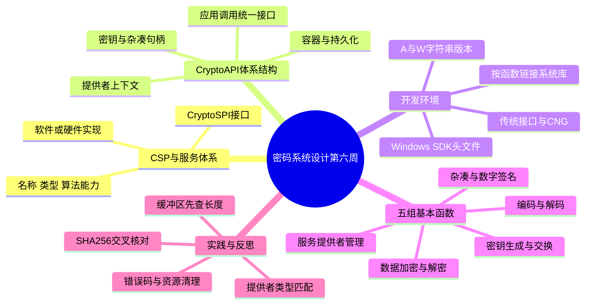
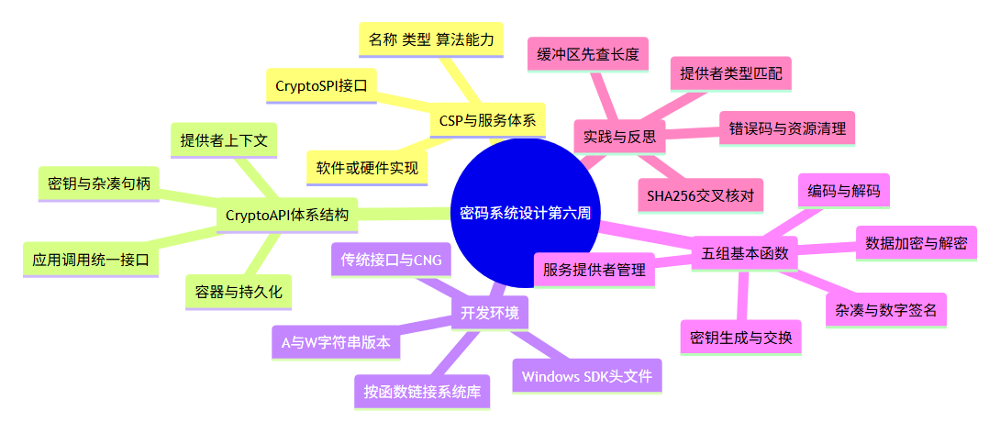

# 密码系统设计 第六周预习报告

**学号**：20241328　**姓名**：蔡贸俊  
**学习内容**：《Windows C/C++加密解密实战》第 9 章“CSP 和 CryptoAPI”  
**课程仓库**：[1515720698/cryptosystem](https://github.com/1515720698/cryptosystem)

## 一、AI 对学习内容的总结（1分）

> 使用的 AI 工具：OpenCode（模型：gpt-6.1-sol）。本报告根据老师要求、教材公开目录及微软官方文档整理，未取得教材第 9 章付费全文；具体接口语义和 CNG 的说明为官方资料补充。

本周的学习主线是：**应用程序提出密码操作请求 → CryptoAPI 提供统一接口 → CSP 完成具体密码服务 → 程序管理句柄、缓冲区和错误。** 前几周主要关注算法和 OpenSSL，本周进一步理解 Windows 如何把密码能力组织成系统服务。

### 1. 9.1—9.4：CSP 的含义、服务体系与组成

CSP 是 Cryptographic Service Provider，即**密码服务提供者**。它提供算法实现及相关密钥管理能力，可以基于软件，也可以连接智能卡等硬件。CSP 不是某一种加密算法，更不能把“安装了 CSP”理解为“支持所有算法”。

从逻辑上看，应用程序调用 CryptoAPI，系统把请求交给相应 CSP。CSP 至少包含实现 CryptoSPI（密码服务提供者接口）的动态链接库；具体计算可能直接在库中进行，也可能由库转交服务进程或硬件完成。因此，“密钥由 CSP 管理”不等于“密钥一定以明文文件保存在本地”。

需要区分三个概念：

| 概念 | 解决的问题 | 本周例子 |
| --- | --- | --- |
| 提供者名称 | 选用哪个具体 CSP | Microsoft Enhanced RSA and AES Cryptographic Provider |
| 提供者类型 | 选用哪一类服务约定 | `PROV_RSA_AES`，数值为 24 |
| 算法标识 | 在该 CSP 中执行哪种算法 | `CALG_SHA_256`，数值为 `0x800C` |

提供者名称和类型应匹配；获得 CSP 上下文后，还要确认该提供者支持所需算法。`PROV_RSA_AES` 是类型名称，并不是“所有操作都使用 RSA 或 AES”：本周用它执行 SHA-256 杂凑。

### 2. 9.5、9.6：体系结构与底层服务调用

可以把调用关系概括为：

```text
应用程序：选择服务、传入数据、检查返回值
    ↓ CryptoAPI
系统密码接口层：定位提供者并转交操作
    ↓ CryptoSPI
CSP：软件实现／服务进程／硬件实现
```

程序一般通过 `CryptAcquireContext` 取得上下文句柄，再把句柄传给其他函数，而不是直接调用某个 CSP 的内部算法函数。

- `HCRYPTPROV`：服务提供者上下文句柄，表示本次操作所处的服务环境。
- `HCRYPTKEY`：密钥对象句柄，用来引用密钥，不等于密钥原始字节。
- `HCRYPTHASH`：杂凑对象句柄，保存某次杂凑操作的状态。
- **密钥容器**：由提供者管理的密钥存储组织，名称用于定位，不等于某个固定磁盘文件，也不等于每次函数调用的句柄。

只进行杂凑、临时密钥操作或公钥验签且不需要访问持久化私钥时，通常采用 `pszContainer=NULL`、`CRYPT_VERIFYCONTEXT`。这个标志并不是“只允许验签”，也不禁止创建临时密钥。

需要使用持久化私钥时，才按业务要求打开相应命名容器。`CRYPT_NEWKEYSET` 表示创建新容器；`CRYPT_MACHINE_KEYSET` 用于机器级容器。打开失败后应先读取错误码，不能对所有错误一律“再创建一次”。

### 3. 9.7、9.8：基本功能与开发环境

CryptoAPI 提供服务提供者管理、密钥生成和交换、编码解码、数据加解密、杂凑及数字签名等能力。相关函数分布在不同系统库中，不能认为凡是 `Crypt` 开头的函数都由同一个 DLL 实现。

Windows C/C++ 学习代码通常包含 `windows.h`、`wincrypt.h`；本周涉及的上下文与杂凑函数链接 `Advapi32.lib`。编码、证书等其他接口应分别核对官方文档的头文件和链接库要求。

```c
#include <windows.h>
#include <wincrypt.h>
#pragma comment(lib, "Advapi32.lib")
```

`#pragma comment` 是 MSVC 的链接指令，换编译器后应使用对应链接参数。字符串接口要区分 `A`（ANSI）与 `W`（Unicode）版本；本周验证显式使用 `CryptAcquireContextW`，避免宏设置与字符串类型不一致。

微软已将这里学习的传统 CSP/CryptoAPI 密码接口标记为弃用，并推荐使用 CNG（Cryptography Next Generation）接口。学习本章仍有助于阅读旧代码和理解系统密码服务，但新开发应结合实际平台选型；不能把这一说明扩大为“所有 Windows 证书 API 都不能使用”。

### 4. 9.9：五组基本加密函数

| 类别 | 代表函数 | 理解重点 |
| --- | --- | --- |
| 服务提供者 | `CryptAcquireContext`、`CryptGetProvParam`、`CryptReleaseContext` | 获取上下文、查询能力、释放资源 |
| 密钥产生和交换 | `CryptGenKey`、`CryptImportKey`、`CryptExportKey`、`CryptDestroyKey` | 区分生成、导入和导出；关注密钥用途与导出权限 |
| 编码／解码 | `CryptEncodeObjectEx`、`CryptDecodeObjectEx` | 在结构与编码字节间转换；编码不提供保密性 |
| 数据加密／解密 | `CryptEncrypt`、`CryptDecrypt` | 检查模式、IV、最终块标志和缓冲区容量 |
| 杂凑与签名 | `CryptCreateHash`、`CryptHashData`、`CryptGetHashParam`、`CryptSignHash`、`CryptVerifySignature` | 区分杂凑状态、摘要结果和签名结果 |

密钥交换不是直接把明文会话密钥发送出去。以数字信封为例，对称密钥用于加密数据，再按协议用接收方公钥保护会话密钥；具体导出格式、算法和填充必须兼容。私钥能否导出还取决于创建标志及提供者策略，不能假定拿到句柄就能导出。

对分组加密，最后一块可能增加填充，所以密文缓冲区不能简单等于明文长度。`CryptEncrypt` 的 `pdwDataLen` 表示有效数据长度并接收输出长度，`dwBufLen` 表示容量，两者含义不同；最后一次调用的 `Final` 也会影响填充处理。

杂凑流程可以具体记为：

```text
CryptAcquireContext → CryptCreateHash → CryptHashData
→ CryptGetHashParam（先查询长度，再取摘要）
→ CryptDestroyHash → CryptReleaseContext
```

获取最终摘要后，不应再把该对象当成未结束的杂凑状态继续追加消息。签名验签还需要合适的密钥与算法参数；验签成功仍只说明消息、签名和公钥匹配，公钥身份绑定要通过可信渠道或证书机制解决。

## 二、对 AI 总结的反思与补充（2分）

> 以下是以学生视角起草的反思，供本人结合教材阅读和操作情况核对。

### 1. AI 总结的问题

1. **只记缩写，仍然分不清层次。**“CryptoAPI 调用 CSP”是一句话，但程序真正拿到的是上下文句柄。我的复习重点应放在“接口、实现、对象引用、持久化存储”各自负责什么，而不是把它们当成同一种东西。
2. **函数清单容易掩盖前置条件。**知道 `CryptCreateHash` 能创建杂凑对象，不代表任意 CSP 都支持 SHA-256。提供者名称、类型和算法能力必须一起考虑。
3. **只讲成功路径，忽略长度和错误。**Windows API 常把长度参数同时作为输入和输出。缓冲区太小后，不重新初始化长度就盲目重试，可能引出新的错误。
4. **沿用教材接口，容易忽略版本背景。**本章用于认识传统 Windows 密码服务；CNG 是后续补充，不能因为旧接口仍能运行，就认为它必然适合所有新项目。

### 2. 自己的补充

**补充一：把句柄理解为“操作凭据”，不要当作密钥内容。**

我可以用“办事窗口—业务凭据—具体对象”帮助理解：CSP 是服务实现，上下文句柄用于访问它，密钥句柄用于引用某个密钥。但这个类比有边界：句柄不是可随意复制到另一进程或另一台机器的密钥，持久化也不能靠把句柄数值写入文件实现。

**补充二：释放句柄与删除持久化密钥是两回事。**

`CryptDestroyHash`、`CryptDestroyKey` 和 `CryptReleaseContext` 用于结束对象使用、释放资源，不能把释放句柄理解为删除容器中的长期密钥。代码通常先销毁依赖上下文的对象，再释放上下文；失败分支也要清理已创建的资源。

**补充三：把编码格式与算法能力分开检查。**

第二周学习过 PEM、DER，前几周又使用 OpenSSL。即使两端都写着 RSA，也不能直接假定 Windows 的密钥 BLOB 就是 PEM/DER，或所有签名字节顺序都一致。跨库时应分别核对密钥编码、签名表示、摘要算法和填充方案，不能靠反复修改数据“试到成功”。

**补充四：国密能力要落实到具体提供者和接口。**

前几周使用过 SM2、SM3、SM4，但统一接口并不保证系统默认 CSP 就支持它们。若要在 Windows 密码服务体系中使用国密，需要确认具体提供者、算法标识、接口文档及适配方式；本周 SHA-256 验证不能作为“已验证国密 CSP”的证据。

## 三、学习思维导图（2分）

### Mermaid 代码



### 思维导图截图



图片由上述 Mermaid 源码实际渲染，独立源文件见 `assets/week6-mindmap.mmd`。

## 四、基于 AI 的学习（2分）

> 学习对话

### 概念一：CSP、上下文句柄和密钥容器有什么区别

**提示词**：我在学习 CSP、上下文句柄和密钥容器，请你以苏格拉底的方式对我进行提问，一次一个问题，帮助我分析“取得上下文是否等于取得私钥”。

**AI 问题 1**：如果已经成功获得 `HCRYPTPROV`，是否说明已经生成了 RSA 密钥对？

**回答**：没有。它说明取得了访问提供者的上下文。生成密钥还需要另外调用相应函数；打开容器和容器内是否已有某种密钥，也不是一回事。

**AI 问题 2**：如果只计算一个字符串的 SHA-256，为什么通常不需要指定长期密钥容器？

**回答**：普通 SHA-256 不需要私钥。可以使用 `NULL` 容器和 `CRYPT_VERIFYCONTEXT` 获取不访问持久化私钥的上下文，避免引入与任务无关的容器依赖。

**AI 问题 3**：`CRYPT_VERIFYCONTEXT` 的名字里有 VERIFY，是不是只能用于验签？

**回答**：不是。它也适合杂凑和临时密钥等场景，重点是不需要访问持久化私钥。不能只根据名字猜标志含义。

**AI 问题 4**：释放上下文后，是否已经删除了长期保存的私钥？

**回答**：没有。释放本次访问使用的资源和删除持久化容器是不同操作。否则程序每次退出都会丢失长期密钥，也就无法在下次启动后继续使用。

**AI 评价小结**：这些回答把服务实现、临时访问状态和持久化存储区分开了。接下来应能独立说明：同一任务是否需要容器、何时需要生成密钥，以及为什么不能把句柄数值当作密钥保存。

### 概念二：为什么“长度参数”和“提供者选择”会影响调用结果

**提示词**：我在学习 CryptoAPI 的缓冲区和提供者参数，请你以苏格拉底的方式对我进行提问，一次一个问题，从 SHA-256 查询失败开始分析。

**AI 问题 1**：SHA-256 的输出为 32 字节，输入只有 3 字节，输出缓冲区能否也只分配 3 字节？

**回答**：不能。摘要长度取决于算法，不是输入长度。即使输入是空消息，SHA-256 也产生 32 字节摘要。

**AI 问题 2**：调用失败后，为什么还要查看长度参数是否被改写？

**回答**：有些 API 会通过长度参数告知所需容量。本周小缓冲区调用返回错误 234，同时把所需长度写为 32。应按接口约定分配并重试，不能只看到失败就换算法。

**AI 问题 3**：把同一个提供者名称的类型从 24 改成 1，为什么还没开始杂凑就失败了？

**回答**：名称和类型不匹配，系统无法按指定组合取得服务。需要先解决上下文获取问题，而不是在后续 `CryptHashData` 里找原因。

**AI 问题 4**：两个程序得到相同 SHA-256，是否就证明文件来源可信？

**回答**：不能。交叉核对说明本次输入和摘要结果一致，普通杂凑没有身份认证能力。要证明来源仍需 HMAC、数字签名或可信分发渠道等机制。

**AI 评价小结**：分析时已经区分服务选择、输入数据、输出容量和认证目标。判断 API 是否正确使用，需要同时关注调用阶段、返回值、错误码及其参数语义。

## 五、学习实践过程遇到的问题与解决方式（2分）

### 1. 实践环境和验证范围

本节由 AI 助手实际执行，环境为 Windows 10 x64（系统版本 `10.0.19045`）、Python 3.12.10。脚本通过 `ctypes` 直接调用 `Advapi32.dll` 中的原生 CryptoAPI；SHA-256 运算由 CSP 完成，再与 Python `hashlib` 比较。这里验证的是实际 Windows API，不把 Python 的摘要函数冒充为 CSP。

运行方式：

```powershell
python code/verify_cryptoapi.py
```

实际使用 `Microsoft Enhanced RSA and AES Cryptographic Provider`、类型 24、`CRYPT_VERIFYCONTEXT`，没有创建持久化密钥容器。脚本和完整结果分别保存在 `code/verify_cryptoapi.py`、`evidence/experiment-log.txt`。

| 验证项 | 结果 |
| --- | --- |
| 获取 CSP 上下文 | 成功 |
| SHA-256 的 1 字节输出缓冲区 | 失败，错误 234，所需容量 32 |
| 查询容量后分配并读取摘要 | 成功，32 字节 |
| `abc`、`abc+LF`、`abc+CRLF` | 三项均与 hashlib 一致，彼此摘要不同 |
| 名称不变，类型从 24 改成 1 | 失败，`0x8009001B` |
| 杂凑对象和上下文释放 | 成功 |

以下问题一、二属于**主动构造的复现验证**；问题三是本次编写验证脚本时实际出现的问题。

### 2. 问题一：提供者名称正确，为什么上下文仍然获取失败

**现象**：保留同一个提供者名称，但把 `dwProvType` 从 `PROV_RSA_AES=24` 改为 `PROV_RSA_FULL=1`，调用失败：

```text
Mismatched provider type: ok=False, error=0x8009001B
```

**AI 排查与解决过程**：先确认失败发生在 `CryptAcquireContextW`，再核对该提供者的类型。错误码对应 `NTE_PROV_TYPE_NO_MATCH`，说明名称与类型组合不匹配。恢复类型 24 后，获取上下文及后续杂凑正常执行。

**核心经验**：提供者名称、类型和算法是不同层次的参数。不能只因为名字里出现 RSA，就随便指定一个带 RSA 的类型；也不能对这种错误使用 `CRYPT_NEWKEYSET` 来“修复”。

### 3. 问题二：创建杂凑成功，读取结果却提示缓冲区不足

**现象**：用 `CALG_SHA_256` 处理 `abc` 后，故意为摘要只分配 1 字节，调用 `CryptGetHashParam` 读取 `HP_HASHVAL=2`：

```text
Small buffer: ok=False, error=234, required=32
```

**AI 排查与解决过程**：错误 234 为 `ERROR_MORE_DATA`。检查发现输出容量不足，长度参数已经给出所需的 32 字节。改用两步法：先传空输出指针查询大小，再分配足够空间读取。

```text
size = 0
CryptGetHashParam(hHash, HP_HASHVAL, NULL, &size, 0)
分配 size 字节缓冲区
CryptGetHashParam(hHash, HP_HASHVAL, buffer, &size, 0)
```

实际得到 `abc` 的 SHA-256：

```text
ba7816bf8f01cfea414140de5dae2223b00361a396177a9cb410ff61f20015ad
```

与 `hashlib.sha256(b'abc')` 一致。另外，`abc`、`abc\n` 和 `abc\r\n` 的输入长度分别为 3、4、5 字节，结果均不同且交叉核对通过。

**核心经验**：缓冲区容量不等于输入数据长度；摘要认证的是实际字节，换行变化也会改变结果。正式代码应始终依据接口约定处理长度和返回值。

### 4. 问题三：错误码明明对应同一数值，断言为什么失败

**实际现象**：第一次执行脚本时，前面的缓冲区和摘要检查均通过，但提供者类型错误码打印成 `0x-7FF6FFE5`，与预期的 `0x8009001B` 比较时触发断言。

**AI 排查与解决过程**：核对发现 `ctypes.get_last_error()` 取出的数值在本次表示中为有符号负数，而 Windows 错误码按 32 位无符号数进行十六进制比较。两者位模式相同。修改为：

```python
error = ctypes.get_last_error() & 0xFFFFFFFF
```

重新运行后输出 `0x8009001B`，全部检查通过。这是错误码的**表示与比较问题**，并不代表改动了 CSP 的失败结果。

**核心经验**：跨语言调用不仅要对照函数名，还要对照数据宽度、指针类型、符号位和调用约定。本例使用指针宽度的 `c_size_t` 表示密码句柄，不能在 64 位环境中随意用 32 位整数代替。

**本周归纳**：我需要掌握的不只是算法名称，还包括从获取服务、创建对象、传入字节、读取结果到清理资源的完整调用链。下一步可把已学的签名验签与 Windows 密钥管理联系起来，再学习 CNG 和证书接口。

## 六、参考资料

- **AI 工具**：[OpenCode](https://opencode.ai/)，模型 gpt-6.1-sol，用于知识整理、示例提问、代码编写及验证。
- **课程要求**：《预习作业要求 (4).md》，第六周指定第 9 章，内容参考第一周模板。
- **教材目录与简介**：[《Windows C/C++加密解密实战》](https://weread.qq.com/web/bookDetail/a0332190813ab78fag011422?wfrom=bookDetailH5)，朱晨冰、李建英，清华大学出版社，第 9 章 9.1—9.9。
- **格式参考**：[仓库第五周报告](https://github.com/1515720698/cryptosystem/tree/master/第5周)，参考六部分结构与附件组织方式。
- **课程导图入口**：[课程 mindmap](https://www.processon.com/mindmap/66bcf83cce68f62ecf3f63fc?from=pwa)。本周导图依据已核对内容自行整理。
- **微软官方文档**：[Cryptographic Service Providers](https://learn.microsoft.com/en-us/windows/win32/seccrypto/cryptographic-service-providers)，本次通过其 [MicrosoftDocs 官方源文件](https://github.com/MicrosoftDocs/win32/blob/docs/desktop-src/SecCrypto/cryptographic-service-providers.md) 阅读，核对 CSP 组成与 CNG 推荐说明。
- **微软官方接口文档**：[CryptAcquireContextW](https://learn.microsoft.com/en-us/windows/win32/api/wincrypt/nf-wincrypt-cryptacquirecontextw)，本次通过其 [MicrosoftDocs 官方源文件](https://github.com/MicrosoftDocs/sdk-api/blob/docs/sdk-api-src/content/wincrypt/nf-wincrypt-cryptacquirecontextw.md) 阅读，核对标志、类型匹配、错误码及临时上下文适用条件。

## 作业提交说明（1分）

1. Markdown：`20241328蔡贸俊《密码系统设计》.md`。
2. PDF：`20241328蔡贸俊《密码系统设计》第6周.pdf`。
3. 思维导图：正文含 Mermaid 代码和截图，移动 Markdown 时保留 `assets` 文件夹。
4. 附件：`code` 为验证与渲染脚本，`evidence` 为运行日志和 PDF 检查资料。
5. 代码托管链接：[20241328蔡贸俊 GitHub 仓库](https://github.com/1515720698/cryptosystem)。个人反思及示例问答请结合本人实际学习情况核对。
