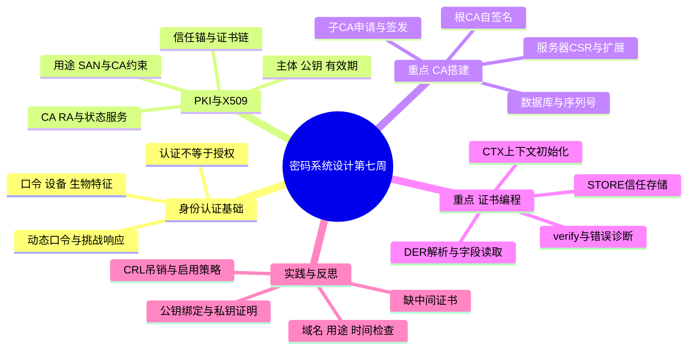
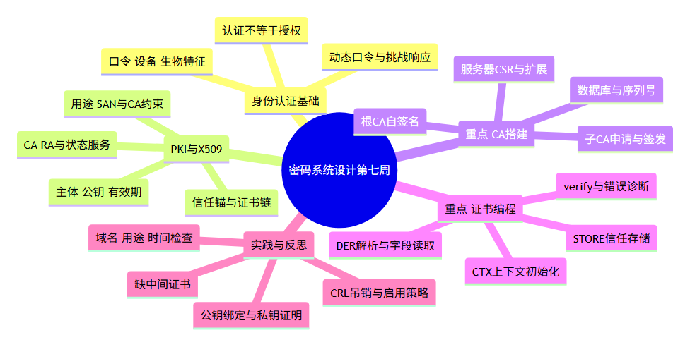

# 密码系统设计 第七周预习报告

**学号**：20241328　**姓名**：蔡贸俊  
**学习内容**：《Windows C/C++加密解密实战》第 10、11 章，重点第 11 章“实战 PKI”  
**课程仓库**：[1515720698/cryptosystem](https://github.com/1515720698/cryptosystem)

## 一、AI 对学习内容的总结（1分）

> 使用的 AI 工具：OpenCode（模型：gpt-6.1-sol）。根据老师要求、教材公开目录及 OpenSSL 官方文档整理；本次未获取教材付费全文，不引用未经核对的页码。域名、用途和吊销检查等内容结合官方文档与实际验证补充。

本周我希望沿着一个问题学习：**前几周已经会签名验签，为什么还需要证书和 PKI？** 签名算法可以检验消息与某个公钥是否匹配，但“这个公钥属于谁、能用来做什么、现在是否仍有效”还需要可信身份绑定与完整的管理流程。

### 1. 第 10 章：身份认证与 PKI 理论基础

#### 1.1 10.1、10.2：身份认证解决什么问题

身份认证用于确认通信参与者声称的身份；授权则决定已认证的主体可以执行哪些操作，两者不能混为一谈。网络中需要考虑冒充、窃听、重放和中间人攻击，也要考虑口令泄露、终端丢失及认证后的会话被盗用。

教材列举的认证技术可以这样比较：

| 方式 | 基本依据 | 需要注意的条件 |
| --- | --- | --- |
| 用户名／密码 | 用户知道的秘密 | 防止泄露、猜测和凭据重放，服务器端妥善处理口令验证数据 |
| 智能卡、USB Key | 用户持有的设备及其中的密钥 | 私钥保护与设备访问控制；常结合 PIN |
| 生物特征 | 用户自身的特征 | 有误识率、拒识率及隐私问题，泄露后难以更换 |
| 动态口令 | 随时间或计数变化的口令 | 验证窗口和重复使用控制；不能直接等同于抗钓鱼 |
| 挑战—响应 | 对本次新鲜挑战计算响应 | 挑战不可预测、避免重复，并绑定协议上下文 |
| 基于证书的认证 | 可信证书绑定公钥，再验证私钥控制能力 | 既验证证书，也验证本次会话中的私钥持有证明 |

“冲击响应”通常也称挑战—响应。验证方发送随机数，持钥方对随机数和相关上下文签名，验证方检查响应。这样可以避免直接发送秘密，但若挑战重复或响应未绑定对象、用途，仍可能产生重放或转发问题。

**拿到一张公开证书并不能证明持有人就是证书主体。**证书可以公开复制，实际认证还需要对方证明能使用相应私钥；这个证明应关联到当前通信。

#### 1.2 10.3、10.4：PKI、X.509 与数字信封

PKI 是 Public Key Infrastructure，即公钥基础设施。它把公钥密码算法、数字证书、可信机构及证书生命周期管理组合起来，支持公钥的可信分发与使用。

- **CA（认证机构）**：按政策签发证书，并参与更新、吊销与状态发布。
- **RA（注册机构）**：承担申请审核、身份核验等注册职责，可与 CA 分离。
- **证书与状态发布服务**：提供证书、CRL（证书吊销列表）或 OCSP（在线证书状态协议）等信息。
- **申请者与依赖方**：前者申请并使用证书，后者根据本地信任策略验证和使用证书。

X.509 证书常见字段包括版本、序列号、签名算法、颁发者、有效期、主体、公钥信息及扩展，最后由颁发者对待签名部分签名。证书通常不包含主体私钥。

| 字段／扩展 | 理解重点 |
| --- | --- |
| Issuer、Subject | 谁签发、证书声明的主体是谁；名字相同并不能单独证明可信 |
| Serial Number | 与颁发者结合标识证书，便于状态和吊销管理 |
| Not Before、Not After | 证书允许使用的时间范围，要结合可信系统时间检查 |
| Basic Constraints | 是否具有 CA 身份及路径长度限制 |
| Key Usage、Extended Key Usage | 密钥操作与应用用途约束，例如签证书或服务器认证 |
| Subject Alternative Name（SAN） | 服务器证书中用于检查目标域名等身份信息 |

根证书往往自签名，但**可信不是自签名自动带来的**。根公钥必须经独立可信渠道成为依赖方认可的信任锚。链验证要检查签名、有效期、CA 约束、用途及路径等，并根据应用要求检查目标身份和吊销状态。

数字信封主要解决高效保密：用随机对称密钥加密正文，再用接收方公钥按相应方案保护该密钥。它与数字签名的目标不同，不能因为使用了接收方公钥就推断发送者身份已经认证。

PKI 可用于网站、设备、代码签名和电子签章等场景；实际部署还涉及跨系统信任、证书更新、密钥保护和状态服务。本周把这些作为理解管理复杂性的例子，不把目录中的“发展现状”扩展成没有数据依据的行业统计。

### 2. 第 11 章重点：从算法到可管理的信任体系

#### 2.1 11.1：只有密码算法是不够的

如果攻击者把自己的公钥发给我，并声称它是老师的公钥，那么我用这把公钥验证攻击者的签名也会成功。算法没有出错，出错的是对公钥身份的信任。因此除了算法，还需要身份审核、证书签发、可信根配置、密钥保护、更新和吊销等环节。

本周实验采用：

```text
Week7 Teaching Root CA（根信任锚）
    └─ Week7 Intermediate CA（中间 CA）
         └─ lab.example.test（服务器证书）
```

根 CA 对中间 CA 的证书签名，中间 CA 对服务器证书签名；验证方从服务器证书向上构建路径，最终连接到本地已经认可的根。中间 CA 可以作为建链材料传入，不必因此成为新的信任锚。

#### 2.2 11.2.1—11.2.3：准备环境和 CA 文件

实验中的根 CA 和中间 CA 分别维护以下内容：

```text
root/ 或 intermediate/
  key.pem       CA 测试私钥
  cert.pem      CA 证书
  index.txt     已签发证书与状态数据库，初始为空
  serial        下一张证书的序列号，初始为十六进制 1000
  crlnumber     下一份 CRL 的编号
  newcerts/     按序列号保存已签发证书
```

本周使用 `openssl ca`，而不是仅用一次 `x509 -req` 就把完整 CA 管理流程略过。配置文件指定数据库、证书、私钥、摘要、签发策略和扩展；`-config` 用于明确采用哪套配置，`-batch` 仅用于这次自动化教学验证。

`serial` 中的 `1000` 是十六进制，转换为十进制为 4096，不能因为显示方式不同就认为证书序列号被修改。本周采用固定初值便于观察；它不表示真实部署都应使用相同编号策略。

#### 2.3 11.2.4—11.2.6：根、子 CA 与普通实体申请

1. **生成根密钥和自签名根证书**：设置 `CA:true`，允许签发证书和 CRL。
2. **生成中间 CA 密钥和 CSR**：CSR 是 Certificate Signing Request，即证书签名请求，包含公钥与申请信息，使用申请者私钥签名。
3. **根 CA 签发中间 CA 证书**：验证 CSR 后，按 CA 自己的策略设置扩展。
4. **普通实体生成密钥与 CSR**：服务器申请使用 `lab.example.test`。
5. **中间 CA 签发服务器证书**：设为 `CA:false`、`serverAuth`，并写入域名 SAN。
6. **验证证书链和应用条件**：提供根信任与中间证书，检查服务器用途和目标域名。

CSR 自签名验证说明请求与对应私钥相关，**不能单独证明申请者确实拥有所申请的域名或现实身份**；这些需要 CA 的注册审核流程。本周是本地教学 CA，未执行真实域名权属审核。

关键扩展采用：

```ini
# 根 CA
basicConstraints = critical,CA:true,pathlen:1
keyUsage = critical,keyCertSign,cRLSign
# 中间 CA
basicConstraints = critical,CA:true,pathlen:0
keyUsage = critical,keyCertSign,cRLSign
# 服务器证书
basicConstraints = critical,CA:false
keyUsage = critical,digitalSignature,keyEncipherment
extendedKeyUsage = serverAuth
subjectAltName = DNS:lab.example.test
```

中间 CA 的 `pathlen:0` 限制其下面的非自颁发中间 CA 数量，并不禁止其签发普通终端证书。配置采用 `copy_extensions=none`，扩展由签发配置明确给出，不无条件照抄 CSR 中的权限声明。

#### 2.4 11.3：OpenSSL 证书编程中的对象与函数

| 对象／操作 | 常用函数 | 需要注意 |
| --- | --- | --- |
| DER 转证书对象 | `d2i_X509` | 检查解析结果；输入指针会随解析前移 |
| 版本、序列号 | `X509_get_version`、`X509_get_serialNumber` | 版本返回 0 基值：2 表示 v3；序列号不应任意缩成小整数 |
| 主体与颁发者 | `X509_get_subject_name`、`X509_get_issuer_name` | 解析姓名不代表已经完成信任验证 |
| 有效期 | `X509_get0_notBefore`、`X509_get0_notAfter` | 返回对象内部借用指针，不由调用者单独释放 |
| 公钥 | `X509_get_pubkey` | 返回持有引用的公钥对象，用后 `EVP_PKEY_free` |
| 信任存储 | `X509_STORE_new`、`X509_STORE_add_cert` | 明确哪些证书是认可的信任锚 |
| 验证上下文 | `X509_STORE_CTX_new`、`X509_STORE_CTX_init` | 区分目标证书、信任存储和未信任的中间链 |
| 路径验证 | `X509_verify_cert` | 只把返回值 1 当成功；失败时读错误码和错误深度 |
| 加入 CRL | `X509_STORE_add_crl` | 还应配置相应验证标志，不能以为加入即自动启用检查 |
| 资源释放 | `X509_STORE_CTX_free`、`X509_STORE_free`、`X509_free` | 根据所有权和引用计数清理，避免重复释放 |

教材中部分有效期接口使用旧名称，OpenSSL 3.x 中可优先使用清晰表达只读借用语义的 `get0` 接口。序列号本次仅为 4096，可以演示为整数；一般程序应使用适当的大整数转换，不能假设都装得进 `long`。

证书验证核心流程为：

```text
读取根、中间和目标证书 → 创建 X509_STORE
→ 将受信根加入 store → 创建 X509_STORE_CTX
→ 初始化 target 与 untrusted 中间链
→ 设置域名、用途、时间和所需状态检查策略
→ X509_verify_cert → 按返回值和错误码决定接受或拒绝
→ 释放上下文、链容器、存储和各证书引用
```

#### 2.5 11.4：证书编程实战与撤销管理

本周除命令行签发外，还通过 `ctypes` 绑定原生 OpenSSL C 接口，实际调用 `d2i_X509`、字段读取、信任存储初始化和 `X509_verify_cert`。这属于对 C API 的实际调用验证，**不是已经编译运行教材 C 程序的记录**。

实验同时实现吊销流程：中间 CA 标记服务器证书为吊销，重新生成 CRL，验证端加载该 CRL 并启用 `-crl_check`。CRL 是带有签名、更新时间和下一更新时间的状态信息；验证端还需确认它可信且在适当的有效期内。本次只检查叶证书吊销，未声称已完成全链 CRL 检查或在线 OCSP 实验。

## 二、对 AI 总结的反思与补充（2分）


### 1. AI 总结的问题

1. **“证书可信”容易讲得太绝对。**可信依赖本地认可的信任锚和验证策略，不是证书有签名、名字像正规机构就可信。自签名本身不能引入外部信任。
2. **“验证证书”常被简化为检查一段签名。**证书签名正确、链能构建、用途正确、域名匹配、当前未吊销，是不同的检查。只完成其中一步就报告“身份认证成功”不够严谨。
3. **“CA 签发成功”并不等于现实身份审核完成。**本地 `openssl ca` 能签出任意测试名字，但真实系统还要验证申请资格和名字控制权。本周实验不能代替真实 CA 的审核。
4. **函数介绍容易忽略对象所有权。**`get0`、取得引用和增加引用的行为不同；同样是“拿到一个指针”，释放规则并不相同。错误分支也必须按已成功创建的对象清理。

### 2. 自己的补充

**补充一：证书、私钥、CSR 应分别记忆。**证书公开声明身份与公钥绑定；私钥用于证明控制能力；CSR 是待 CA 审核签发的请求。服务器把证书发给对方，并不需要把私钥也发过去。

**补充二：把建链材料与信任锚分开。**我可以接收服务器发送的中间 CA 证书帮助建链，但不能因为收到它就自动信任它。实验中 `-CAfile` 放根，`-untrusted` 放中间证书，正好体现两者角色不同。

**补充三：身份认证之后仍要判断权限。**即使证书证明对方是某个学生，也不能据此授予教师权限。应用还要映射账号、角色、资源及有效会话；吊销、证书更新与账号停用也需要协调。

**补充四：与前几周联系起来。**第二周的 DER／PEM 解释证书如何编码；第三周的杂凑和第五周的数字签名支撑证书签名；第六周的密钥句柄与容器说明私钥如何被系统管理。本周把这些能力组合成可分发、可验证、可更新和可吊销的信任体系，后续 TLS 学习还要将证书验证与握手中的私钥持有证明结合。

## 三、学习思维导图（2分）

### Mermaid 代码



### 思维导图截图



图片由上述 Mermaid 源码实际渲染，独立源文件见 `assets/week7-mindmap.mmd`。

## 四、基于 AI 的学习（2分）

### 概念一：根证书为什么能成为信任起点

**提示词**：我在学习根证书、证书链和身份认证，请你以苏格拉底的方式对我进行提问，一次一个问题，从“攻击者也能自签名”开始。

**AI 问题 1**：如果攻击者也能生成一个自签名证书，自签名为什么不能自动证明可信？

**回答**：自签名只能说明它的签名与其中的公钥对应。攻击者可以自己选择名字和密钥，所以还需要通过可信渠道确认这把根公钥是否被认可。

**AI 问题 2**：服务器发来一个中间 CA 证书，接收方是否应该立即信任它？

**回答**：不应该。它只是建链候选材料，还要验证签名、CA 资格和约束，并连接到已经信任的根。否则攻击者可以发送自己的中间证书。

**AI 问题 3**：服务器证书能连接到可信根，为什么访问错误域名时仍然应被拒绝？

**回答**：证书链说明签发关系可被接受，但还要确认它授权的是本次访问的对象。给 `lab.example.test` 的证书不能直接用于 `wrong.example.test`。

**AI 问题 4**：别人复制了服务器公开证书，是否就能以同样身份完成认证？

**回答**：不能仅凭复制证书做到。认证协议还要要求对方在当前会话中证明控制对应私钥。证书是身份与公钥的绑定声明，不是秘密口令。

**AI 评价小结**：回答已区分外部信任起点、链构建、目标身份和私钥控制证明。还应能够独立解释为什么把任意收到的证书加入信任存储，会改变而不是“修好”信任策略。

### 概念二：证书未过期，为什么还可能不能使用

**提示词**：我在学习证书生命周期、CRL 和验证策略，请你以苏格拉底的方式对我进行提问，一次一个问题，从“私钥泄露但证书还在有效期内”开始。

**AI 问题 1**：证书有效期还有一年，但服务器私钥今天泄露，能否继续只看有效期接受它？

**回答**：不能。有效期不是实时的安全状态。CA 需要吊销证书并发布状态，验证方也要按策略获得、验证和使用这些状态信息。

**AI 问题 2**：CA 在自己的数据库把证书标记为吊销，所有验证方会立即自动知道吗？

**回答**：不会。数据库更新不会自动修改已经发出去的证书。需要发布新的 CRL 或提供 OCSP 等状态服务，验证方获取后才能知道。

**AI 问题 3**：把 CRL 文件放在证书旁边，是否就等于已启用吊销检查？

**回答**：不是。本周必须通过参数加载 CRL 并启用 `-crl_check` 才检查叶证书的吊销状态。仅运行普通链验证仍可能显示 OK。

**AI 问题 4**：如果拿到一份很旧但签名正确的 CRL，是否足够？

**回答**：还不够。需要检查发布者、适用范围和新鲜度，不能只看 CRL 的签名。旧状态可能尚未包含刚吊销的证书。

**AI 评价小结**：回答把证书静态内容、CA 数据库和依赖方使用的状态信息区分开了。进一步学习时应理解 CRL 与 OCSP 的时效和可用性策略，不能把“命令执行成功”当作所有验证条件都已开启。

## 五、学习实践过程遇到的问题与解决方式（2分）

### 1. 实践环境、命令与实际结果

环境为 Windows 10 x64（`10.0.19045`）、Python 3.12.10、OpenSSL 3.5.9。命令行采用 Git for Windows 附带的 OpenSSL；原生 C API 通过同版本的 `libcrypto-3-x64.dll` 调用。

```powershell
python code/run_pki.py
python code/verify_x509_api.py
```

脚本支持 `--openssl` 和 `--libcrypto` 参数指定工具路径。实际命令、配置和日志均已保存。RSA 测试密钥为 2048 位，证书采用 SHA-256 签名；临时工作目录退出时清理测试私钥，交付保留公开证书、CSR、CRL 及日志。

| 命令行检查 | 实际结果 |
| --- | --- |
| 完整链、服务器用途和正确域名 | OK，链深度为 0、1、2 |
| 缺少中间证书 | 错误 20，深度 0 |
| 不配置信任根 | 错误 20，深度 1 |
| 错误域名 | 错误 62，hostname mismatch |
| 用服务器证书验证客户端用途 | 错误 26，unsuitable certificate purpose |
| 将验证时间设置到叶证书到期以后 | 错误 10，certificate has expired |
| 吊销前 CRL，启用检查 | OK |
| 吊销后 CRL，启用检查 | 错误 23，certificate revoked |
| 已吊销但不启用 CRL 检查 | 普通链验证仍显示 OK |
| PEM→DER→PEM | SHA-256 证书指纹保持一致 |

原生 X.509 接口另外完成 3 项检查：完整链返回 1；缺少中间证书返回 0、错误 20；错误域名返回 0、错误 62。字段读取结果为：版本原始值 2（v3）、序列号 4096、主体 `lab.example.test`、颁发者 `Week7 Intermediate CA`。

### 2. 问题一：根证书已经提供，为什么还提示找不到颁发者

**现象（复现验证）**：只指定根证书验证服务器证书，报错：

```text
error 20 at 0 depth lookup: unable to get local issuer certificate
```

**AI 排查思路**：服务器证书由中间 CA 签发，根并没有直接给服务器签名。验证方缺少的是中间证书，不能仅根据“已经有根”就认为链完整。

**解决与验证**：把中间证书作为 `-untrusted` 建链材料传入，保留根作为本地信任锚。对交付的公开证书可运行：

```powershell
openssl verify -CAfile evidence/root-cert.pem -untrusted evidence/intermediate-cert.pem -purpose sslserver -verify_hostname lab.example.test evidence/server-cert.pem
```

实际完整链验证通过。这里的 `untrusted` 指“不能因为出现在这个集合就直接信任”，不是说它一定非法。

**核心经验**：先检查路径缺哪一环，不要把叶证书或收到的中间证书随意升级成信任锚来消除错误。

### 3. 问题二：链验证通过，为什么域名或用途仍然不对

**现象（复现验证）**：相同证书链下，把目标域名改成 `wrong.example.test`，得到错误 62；将用途要求改为 `sslclient`，得到错误 26。

**AI 排查思路**：链验证不是一个与业务无关的“真假检测器”。证书的 SAN 只包含 `lab.example.test`，EKU 只允许服务器认证，因此不满足错误域名或客户端认证要求。

**解决与验证**：按实际访问对象与业务角色配置 `-verify_hostname lab.example.test`、`-purpose sslserver`，验证成功。真实应用需要把预期主机名来自可信配置，而不是直接相信证书自行声明的名字。

**核心经验**：正确的解决方案是使证书用途与业务相符；不能删除域名和用途检查，仅为了让验证变绿。

### 4. 问题三：已经吊销证书，为什么再次验证还显示 OK

**现象（复现验证）**：中间 CA 吊销服务器证书后，执行普通 `verify` 仍显示 OK。

**AI 排查思路**：证书文件没有因为数据库状态变化自动改变，普通验证也没有自动启用在线查询。需要重新生成 CRL，把它交给验证方，并明确启用检查。

本次实际执行的吊销流程如下，配置和工作目录由脚本创建：

```powershell
openssl ca -config intermediate.cnf -revoke server-cert.pem -crl_reason keyCompromise
openssl ca -config intermediate.cnf -gencrl -out after.crl.pem
```

针对公开附件的复核命令：

```powershell
openssl verify -CAfile evidence/root-cert.pem -untrusted evidence/intermediate-cert.pem -CRLfile evidence/after.crl.pem -crl_check evidence/server-cert.pem
```

实际结果：

```text
error 23 at 0 depth lookup: certificate revoked
```

**核心经验**：吊销要形成“标记—发布—获取—验证并启用策略”的闭环。`-crl_check` 本例检查叶证书，不能把它说成已检查全链。公开附件中的 CRL 仅有 7 天有效期，之后复核可能同时遇到 CRL 过期；此时应重新运行脚本生成新的教学材料。

### 5. 实践小结与附件

命令行日志最后为 `ALL 10 CHECKS PASSED`，接口日志最后为 `ALL 3 API CHECKS PASSED`。失败案例均为主动设置条件后的预期拒绝，不是把错误输出当作程序崩溃，也不是本人过去故障经历的虚构记录。

- `code/run_pki.py`：初始化 CA、签发、CRL、10 项验证与证据导出。
- `code/root.cnf`、`code/intermediate.cnf`：本次实际采用的签发配置快照。
- `code/verify_x509_api.py`：原生 X.509 C API 绑定、字段读取与 3 项验证。
- `evidence/experiment-log.txt`、`evidence/x509-api-log.txt`：完整命令和实际结果。
- `evidence/*-cert.pem`、`server-cert.der`、`*.crl.pem`：公开复核材料。

## 六、参考资料

- **AI 工具**：[OpenCode](https://opencode.ai/)，模型 gpt-6.1-sol，用于总结、示例提问、脚本与实际验证。
- **课程要求**：《预习作业要求 (4).md》，第七周学习第 10、11 章，重点第 11 章。
- **教材公开目录**：[《Windows C/C++加密解密实战》](https://weread.qq.com/web/bookDetail/a0332190813ab78fag011422?wfrom=bookDetailH5)，朱晨冰、李建英，清华大学出版社；定位第 10 章 10.1—10.4、第 11 章 11.1—11.4。
- **课程导图入口**：[课程 mindmap](https://www.processon.com/mindmap/66bcf83cce68f62ecf3f63fc?from=pwa)，本周导图根据已核对材料自行整理。
- **OpenSSL 官方文档**：[openssl-ca](https://docs.openssl.org/3.5/man1/openssl-ca/)，CA 数据库、签发配置、扩展处理、吊销和 CRL。
- **OpenSSL 官方文档**：[openssl-verify](https://docs.openssl.org/3.5/man1/openssl-verify/)，信任锚、中间证书、域名、用途、验证时间和 CRL 参数。
- **OpenSSL 官方文档**：[X509_verify_cert](https://docs.openssl.org/3.5/man3/X509_verify_cert/)，证书链验证接口与返回值。

## 作业提交说明（1分）

1. Markdown：`20241328蔡贸俊《密码系统设计》.md`。
2. PDF：`20241328蔡贸俊《密码系统设计》第7周.pdf`。
3. 导图：正文含 Mermaid 源码和 PNG；移动 Markdown 时保留 `assets` 文件夹。
4. 附件：`code` 为脚本与配置，`evidence` 为公开证书、CRL、运行结果和 PDF 检查资料。
5. 可选代码托管链接：[20241328蔡贸俊 GitHub 仓库](https://github.com/1515720698/cryptosystem)。个人反思与学习示例问答请结合本人实际学习情况核对。
