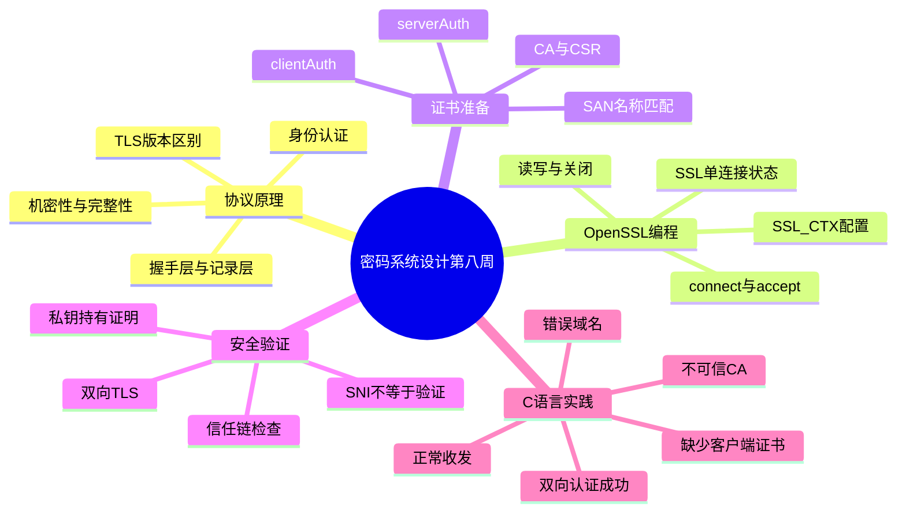
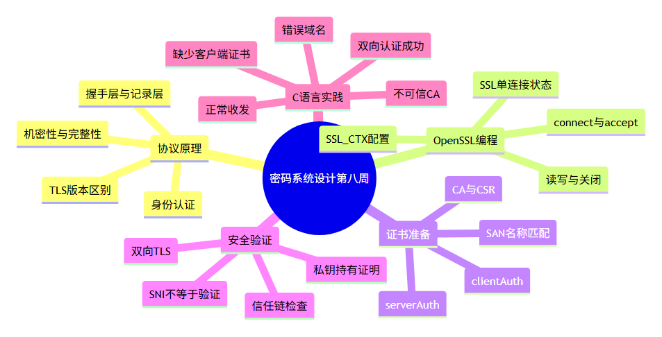

# 密码系统设计 第八周预习报告

**学号**：20241328　**姓名**：蔡贸俊  
**学习内容**：《Windows C/C++加密解密实战》第 12 章：SSL-TLS 编程

## 一、AI 对学习内容的总结

> 使用的 AI 工具：OpenCode（模型：openai/gpt-6-astra）。
> 资料说明：已核对老师《预习作业要求.md》和微信读书公开目录，第 12 章包括 12.1—12.5。教材正文未取得，以下按公开目录组织，结合 OpenSSL 3.0 官方文档和实际 C 程序验证整理，不作为教材原文摘录。课程 ProcessOn 链接只能读取页面界面，未能取得导图节点；本报告导图为本周学习内容的自主整理。

### 1. SSL 协议规范（12.1）

SSL（安全套接层）及其后继 TLS（传输层安全协议）用于保护网络通信。通常的 HTTPS 协议栈是“HTTP → TLS → TCP → IP”。TCP 提供可靠字节传输，TLS 在此基础上提供机密性、完整性保护，以及基于证书等机制的身份认证。HTTPS 还需要 HTTP 请求和响应语义，并不是任意 TLS 程序都属于 HTTPS。

**协议的发展与使用条件。** 教材以 SSL 为历史入口，但现代程序应使用 TLS。SSL 2.0/3.0 和 TLS 1.0/1.1 不应作为新系统的协议选择。本次程序设置最低 TLS 1.2，双方实际协商为 TLS 1.3。OpenSSL 函数名中的 `SSL_` 是 API 名称，不能据此判断正在使用 SSL 3.0。

**TLS 解决的三个主要问题：**

- 机密性：应用数据使用协商出的对称密钥加密；仅监听链路的人不能直接读取明文。
- 完整性：现代 TLS 通过认证加密等机制检测记录被修改。发现错误应终止连接，不能继续接受可疑数据。
- 身份认证：验证证书链、有效期、用途、目标名称等，并结合握手中的私钥持有证明，确认通信对象。单向 TLS 通常只认证服务器；双向 TLS 还认证客户端。

**记录层与握手层。** 记录层对上层数据进行分片、封装与密码保护；握手协议协商参数、建立密钥并完成认证；告警协议传递失败和关闭通知。TLS 1.2 的 ChangeCipherSpec 与 TLS 1.3 的兼容消息不能简单视为同一套握手步骤。历史 SSL/TLS 中的压缩、CBC 和 MAC 组合不应不加区分地套用于 TLS 1.3。

以**使用证书认证的 TLS 1.3 完整握手**为例，可用以下顺序理解：

1. 客户端发送 ClientHello，提出版本、密码套件、密钥共享参数等。
2. 服务器通过 ServerHello 选择参数，双方计算共享秘密并派生握手密钥。
3. 服务器发送加密扩展、证书、CertificateVerify 和 Finished。证书建立身份与公钥的绑定；CertificateVerify 证明对应私钥的持有；Finished 校验握手记录。
4. 客户端验证服务器；若服务器请求客户端认证，客户端还发送证书和签名，然后发送 Finished。
5. 双方使用应用流量密钥保护业务数据。认证加密 AEAD 同时提供机密性与完整性保护。

这不是所有握手的逐包清单：会话恢复、预共享密钥和 HelloRetryRequest 等情形有所不同。证书私钥主要用于认证，并不是直接加密全部业务数据；TLS 1.3 也不采用旧式 RSA 密钥传输方式。

### 2. OpenSSL 中的 SSL 编程（12.2）

OpenSSL 将连接配置和单条连接分开：`SSL_CTX` 保存协议版本、证书、信任根等配置；`SSL` 保存某一条连接的握手、记录和读写状态。一个上下文可以用于创建多个连接对象，但不能把多条连接的状态混用。

客户端流程：创建 TCP 套接字并连接 → 创建和配置上下文 → `SSL_new` → `SSL_set_fd` → 设置服务器名称和验证目标 → `SSL_connect` → 安全读写 → 关闭 TLS → 释放对象和套接字。配置上下文与建立 TCP 的先后可调整，但握手前必须完成所需配置。

服务端流程：加载证书和私钥并检查匹配 → TCP `bind/listen/accept` → 为接受的连接创建 `SSL` → `SSL_accept` → 安全读写 → 清理资源。操作系统的 `accept()` 接受 TCP 连接，OpenSSL 的 `SSL_accept()` 执行 TLS 握手，两者不能替代。

### 3. SSL 函数及现代 API 对照（12.3）

| 教材相关函数 | 作用与使用注意 |
|---|---|
| `SSL_library_init` | 历史初始化入口；OpenSSL 1.1.0 及以后通常自动初始化。 |
| `SSL_CTX_new` / `SSL_CTX_free` | 创建和释放上下文；现代代码选 `TLS_client_method()` 或 `TLS_server_method()`，另外设置最低协议版本。 |
| `SSL_CTX_use_certificate_file` / `SSL_CTX_use_certificate` | 分别从文件或已有 X.509 对象加载本端证书；需要发送中间证书时可使用 `SSL_CTX_use_certificate_chain_file`。 |
| `SSL_CTX_use_PrivateKey_file` / `SSL_CTX_use_PrivateKey` | 分别从文件或已有密钥对象设置本端私钥；私钥不应随证书发送。 |
| `SSL_CTX_check_private_key` | 检查证书中的公钥与本地私钥是否匹配；匹配不等于证书可信。 |
| `SSL_new` / `SSL_free` | 创建、释放单条 TLS 连接对象。 |
| `SSL_set_fd` | 将套接字关联到 TLS 对象；`SSL_set_rfd`、`SSL_set_wfd` 可分别指定读、写描述符。 |
| `SSL_connect` / `SSL_accept` | 分别执行客户端、服务端握手；必须检查返回值。 |
| `SSL_get_peer_certificate` | 获取对端证书的旧接口；OpenSSL 3.0 可用 `SSL_get1_peer_certificate`，所得引用用 `X509_free` 释放。拿到证书不代表验证成功。 |
| `SSL_write` / `SSL_read` | 发送、接收应用数据；实际 C 函数名是 `SSL_read`，注意大小写。本次使用 `SSL_write_ex` / `SSL_read_ex`，单独获得处理字节数。 |

在这些函数之外，安全通信还需要显式配置验证策略：

```c
SSL_CTX_set_min_proto_version(ctx, TLS1_2_VERSION);
SSL_CTX_load_verify_locations(ctx, "ca.pem", NULL);
SSL_CTX_set_verify(ctx, SSL_VERIFY_PEER, NULL);
/* ssl 已由 SSL_new(ctx) 创建；以下调用均应检查返回值。 */
SSL_set_tlsext_host_name(ssl, "localhost");
SSL_set1_host(ssl, "localhost");
```

第一行限制最低版本；第二行加载本程序信任的 CA；第三行要求验证失败时中止握手。SNI（服务器名称指示）用于告知服务器希望访问哪个虚拟主机；`SSL_set1_host` 才设置证书名称验证目标，**设置 SNI 不等于完成域名验证**。

发生错误时，应及时将原调用返回值传给 `SSL_get_error`，并查看 OpenSSL 错误队列。非阻塞程序还须正确处理 `SSL_ERROR_WANT_READ` 与 `SSL_ERROR_WANT_WRITE`，等待就绪后重试。本次是带超时的阻塞教学程序，不实现非阻塞事件循环。

### 4. 准备 SSL 通信所需的证书（12.4）

证书准备把上一周的 PKI 学习与本周网络编程连接起来：

1. 创建实验 CA 密钥与根证书，标明 CA 约束和证书签发用途。
2. 服务端生成自己的密钥和证书签名请求 CSR；由 CA 签发服务端证书。
3. 服务端证书的 SAN（主题备用名称）包含访问名称，本次为 `DNS:localhost`；扩展密钥用途设为 `serverAuth`。
4. 双向 TLS 时，客户端也生成密钥、CSR 和证书，扩展密钥用途设为 `clientAuth`。
5. 客户端加载信任的 CA；需要认证客户端时，服务端也加载其信任的 CA，并强制要求客户端证书。

根证书成为信任锚，是因为被可信地配置进本地信任库，而不是因为“自签名”本身能证明可信。部署中如存在中间 CA，需要正确提供证书链。证书撤销检查需要另外配置，不能从本次加载 CA 的代码推断已经启用 CRL 或 OCSP。

### 5. 实战 SSL 网络编程（12.5）

本次编写 `code/tls_demo.c`，同一源文件通过参数分别运行客户端、服务端。连接仅使用本机回环地址；客户端发送固定 5 字节 `HELLO`，服务端返回固定 4 字节 `PONG`。双方检查数据、TLS 关闭过程及退出状态，避免把“握手函数返回成功”误当作完整业务成功。

TLS 提供可靠字节流接口，不保留应用消息边界。一次写入不保证一次读取完整得到；代码循环累计读写字节数。本例采用固定长度消息，真实应用还可使用长度前缀或明确分隔符，并限制消息大小。

服务端强制双向认证的关键配置为：

```c
SSL_CTX_set_verify(ctx,
    SSL_VERIFY_PEER | SSL_VERIFY_FAIL_IF_NO_PEER_CERT, NULL);
```

只有 `SSL_VERIFY_PEER` 时，服务端会请求客户端证书，但不能据此保证缺证书一定被拒绝；还需要组合 `SSL_VERIFY_FAIL_IF_NO_PEER_CERT`。验证回调也不能无条件返回成功来掩盖证书错误。

## 二、对 AI 总结的反思与补充

> 第 1、2 条认识与第四部分的本人实际回答及 AI 反馈对应；其余扩展反思由 AI 根据本次实验起草，待本人核对后可进一步用自己的语言修改。

### 1. AI 总结的问题

1. “加密就安全”过于简化。本人首先指出可能发生中间人攻击；补充分析后应明确，攻击者可能终止并重建两段加密连接，而不需要破解密码算法。加密必须结合身份验证。
2. “客户端提供私钥证明身份”容易产生歧义。本人最初提到“设备的私钥什么的”，AI 指出私钥不应发送，应该发送证书并生成握手签名。这一纠正比只记住“双向认证”术语更重要。
3. 只列 `SSL_connect`、`SSL_read` 等函数不能体现安全条件。应同时说明信任根、目标名称、返回值、数据长度及资源生命周期，否则程序可能“能运行但不安全”。
4. 将 SSL 与 TLS 的所有版本放在一起描述容易误导。TLS 1.3 的握手和密码套件结构与旧版本有差异，应标清版本；错误字符串含 `ssl3` 也不等于实际使用 SSL 3.0。

### 2. 自己的补充

1. **信任链与名称匹配是两道检查。** 本人对“可信 CA 签发但属于另一网站的证书”选择拒绝；实验进一步表明，CA 不可信与域名不匹配会分别产生不同错误。
2. **证书公开，私钥保密。** 本人进一步回答，复制证书者无法完成有效签名。证书不是秘密口令，认证要验证其持有者是否掌握对应私钥。
3. **身份认证与业务授权分开。** 即使双向 TLS 认证通过，也只说明连接者满足证书验证规则；能否访问某项业务仍需要角色和权限判断。证书身份不自动等于管理员权限。
4. **联系国密体系时应注明边界。** 学过 SM2、SM3、SM4 不代表当前 TLS 库默认就使用这些算法。本次实际套件为 `TLS_AES_256_GCM_SHA384`，不把它写成国密通信；TLCP 与 TLS 也不能仅靠替换算法名称就视为同一种协议。

## 三、学习思维导图





## 四、基于 AI 的学习

以下整理自本次与 OpenCode 的真实交互。本人回答按原文记录；AI 提问及反馈在不改变含义的前提下压缩整理，最终评价由 AI 根据实际回答给出。

### 1. 概念一：加密连接与服务器身份验证

**AI 提问 1：** 客户端已经与服务器建立加密连接，但没有验证证书，能确定对方是真正的网站吗？为什么？

**本人回答：** “不能确定，可能遭遇类似中间人攻击，导致加密信息被篡改”。

**AI 反馈：** 判断正确。攻击者可能分别与客户端和真正的服务器建立连接，解密后修改，再加密转发。问题不是一定破解了 TLS，而是没有确认加密连接另一端的身份。

**AI 追问 2：** 证书由可信 CA 签发且未过期，但属于 `other.example`，访问目标是 `bank.example`，应该接受吗？

**本人回答：** “应该拒绝”。

**AI 补充解释：** 可信 CA 的签名证明的是证书所列身份，还须核对该身份是否与访问目标一致。程序中信任链验证与 `SSL_set1_host` 应配合使用。

**AI 评价小结：** 已正确识别中间人风险，并对名称不匹配作出正确选择。第二个回答尚未展开理由，因此不能据此声称已独立完整解释证书验证；建议结合错误码 19、62 进一步练习区分两种失败原因。

### 2. 概念二：双向 TLS 与私钥持有证明

**AI 提问 1：** 内部系统需要服务器确认连接者是持有指定证书的设备，仅有服务器证书够不够？客户端还应提供什么？

**本人回答：** “不够，还需要提供能证明设备身份的内容，例如设备的私钥什么的”。

**AI 反馈：** 抓住了需要证明设备身份的关键，但私钥不能发送给服务器。客户端应发送证书，并使用私钥对握手相关数据签名；服务器用证书中的公钥验证，从而确认私钥持有者参与本次握手。

**AI 追问 2：** 如果有人复制合法设备的客户端证书，但没有对应私钥，能否仅凭证书完成双向 TLS 认证？为什么？

**本人回答：** “不能，他不能证明自己的身份，无法合规完成签名”。

**AI 评价小结：** 已理解只有公开证书不足以冒充设备，关键是能否生成可由证书公钥验证的有效签名。最初关于“提供私钥”的表述已得到纠正；进一步学习应联系服务器请求客户端证书的配置，以及认证后仍需业务授权的边界。

## 五、学习实践过程遇到的问题与解决方式

### 1. 实验环境、步骤与结果

本节为本次由 OpenCode 实际执行的验证，负向场景是**主动构造的复现验证**，不是声称本人此前发生过这些故障。环境：Windows 主机上的 WSL2/openEuler，Linux 内核 `6.18.33.2-microsoft-standard-WSL2`，GCC 12.3.1，OpenSSL 3.0.12，Python 3.11.6。Python 仅负责证书命令调用、进程调度和日志记录，实际 TLS 通信由编译后的 C 程序完成。

在第8周目录执行：

```bash
python3 code/run_tls.py
```

脚本先调用 `openssl req` 和 `openssl x509` 创建实验 CA、服务端与客户端证书，再按下列方式编译，之后自动启动双方进程：

```bash
gcc -std=c11 -Wall -Wextra -Werror code/tls_demo.c \
  -o tls_demo -lssl -lcrypto
# 示例参数格式；实际端口及文件位于脚本创建的临时目录。
./tls_demo server PORT ca.pem server.pem server.key 1
./tls_demo client PORT ca.pem localhost client.pem client.key
```

`-lssl -lcrypto` 链接 TLS 和密码库；最后一个服务端参数 `1` 表示强制客户端证书。脚本使用动态选择的本机端口和两天有效期的测试证书，实验结束清理临时私钥、CSR 与可执行文件；重新运行会自动生成新的测试材料。

| 验证场景 | 实际结果 | 判定 |
|---|---|---|
| 正确信任根与 `localhost` | TLS 1.3；双方收到 HELLO/PONG，退出码均为 0 | 通过 |
| 客户端仅信任另一 CA | 客户端验证错误 19；服务端收到 `unknown ca` 告警 | 按预期拒绝 |
| 目标名称改为 `wrong.example` | 客户端验证错误 62：`hostname mismatch` | 按预期拒绝 |
| 服务端要求双向认证、客户端无证书 | 服务端报告 `peer did not return a certificate`；客户端读数据时收到拒绝告警 | 按预期拒绝 |
| 双向认证且客户端证书与私钥齐全 | 双方对端证书存在；完成 HELLO/PONG，退出码均为 0 | 通过 |

成功场景协商套件均为 `TLS_AES_256_GCM_SHA384`。三个负向场景的双方退出码均为 1，且未出现 `EXCHANGE_OK`。完整命令和输出保存在 `evidence/experiment-log.txt`，结构化结果保存在 `evidence/results.json`。

### 2. 问题一：证书验证失败，如何区分信任链与名称问题？

**现象（复现验证）：** 只信任另一 CA 时，客户端显示：

```text
HANDSHAKE_FAIL ssl_error=1 verify=19
(self-signed certificate in certificate chain)
```

恢复正确 CA、把目标名称改为 `wrong.example` 后，显示：

```text
HANDSHAKE_FAIL ssl_error=1 verify=62 (hostname mismatch)
```

**解决过程：** 先保持名称为 `localhost`，检查 `SSL_CTX_load_verify_locations` 加载的是否为签发服务器证书的实验 CA；再检查 SAN 和 `SSL_set1_host` 是否一致。恢复正确 CA 与名称后，正常收发验证通过。处理失败时没有关闭证书验证，也没有用恒为成功的回调绕过错误。

**核心经验：** “证书验证失败”不是单一原因。应结合验证结果、对端告警、配置和证书内容定位；不可直接把所有错误都归为证书过期。

### 3. 问题二：客户端显示握手完成，为什么仍然认证失败？

**现象（复现验证）：** 服务端强制双向认证，但客户端不加载证书。客户端先输出 TLS 1.3 的 `HANDSHAKE_OK`，随后读取时出现：

```text
TLS read error=1
tlsv13 alert certificate required
```

服务端则报告：

```text
HANDSHAKE_FAIL ssl_error=1 verify=0 (ok)
peer did not return a certificate
```

**解决过程：** 同时检查客户端和服务端日志，而不是只看客户端 `SSL_connect` 的返回。在 TLS 1.3 中，客户端本地完成握手流程后，服务器对客户端认证的拒绝仍可能在后续 I/O 中被观察到。给客户端加载合法证书和对应私钥后，双方握手、应用收发和关闭均成功。

**核心经验：** 应用数据往返和双方返回状态也是成功判据。服务端日志中的 `verify=0 (ok)` 不能单独证明客户端已认证，因为这里没有收到客户端证书；还须结合握手返回值、证书是否存在以及错误队列判断。

### 4. 问题三：负向测试拒绝正确，为何测试脚本仍显示 FAIL？

**现象（实际调试）：** 第一轮完整执行时，`untrusted_ca` 场景中双方实际都拒绝了连接，但脚本判为 FAIL，其余四组通过。

**解决过程：** 原断言把不可信 CA 的文本写死为 `unable to get local issuer certificate`，而本次日志实际为错误 19：`self-signed certificate in certificate chain`，服务端同时收到 `alert unknown ca`。因此修正的是断言，不是放宽 TLS 验证。更新后的条件同时检查双方失败退出、无成功交换标记和 `unknown ca` 告警，再完整重跑五组测试，全部通过。

```text
trusted_server PASS
untrusted_ca PASS
hostname_mismatch PASS
mtls_missing_client PASS
mtls_valid_client PASS
```

**核心经验：** 测试应围绕安全行为及实际失败原因设计，而不是假定不同证书链呈现方式总会返回同一句错误文本。第一轮日志和结果保留为 `evidence/previous-experiment-log.txt`、`evidence/previous-results.json`，便于核对修正前后。

另一次脚本启动错误是 Python 函数内用 `LOG += [...]` 导致作用域判定为局部变量，触发 `UnboundLocalError`；改为 `LOG.extend([...])` 后解决。此错误发生在 TLS 实验启动前，不将其当作 TLS 协议故障。

## 六、参考资料

1. 老师发布的《预习作业要求.md》：第八周学习内容，以及第一周报告结构、评分点与文件命名要求。
2. 朱晨冰、李建英：《Windows C/C++加密解密实战》，清华大学出版社，2021。使用[微信读书公开目录](https://weread.qq.com/web/bookDetail/a0332190813ab78fag011422)核对第 12 章 12.1—12.5 范围，未取得章节正文。
3. OpenSSL 3.0：[SSL/TLS 库概览](https://docs.openssl.org/3.0/man7/ssl/)。本次读取其官方仓库对应 `doc/man7/ssl.pod` 源文档，核对上下文、连接与读写流程。
4. OpenSSL 3.0：[SSL_CTX_set_verify](https://docs.openssl.org/3.0/man3/SSL_CTX_set_verify/)、[SSL_set1_host](https://docs.openssl.org/3.0/man3/SSL_set1_host/)。本次读取官方仓库对应 POD 文档，核对验证标志、默认行为及主机名校验。
5. [课程 mindmap（ProcessOn）](https://www.processon.com/mindmap/66bcf83cce68f62ecf3f63fc?from=pwa)：老师指定资料，本次访问只能取得页面界面，节点内容待取得可访问导出版本后补核。
6. [OpenCode](https://opencode.ai/)：本次实际使用模型为 `openai/gpt-6-astra`，用于总结、交互提问、代码编写、执行与报告整理；第五部分数据来源于随附真实运行记录。
